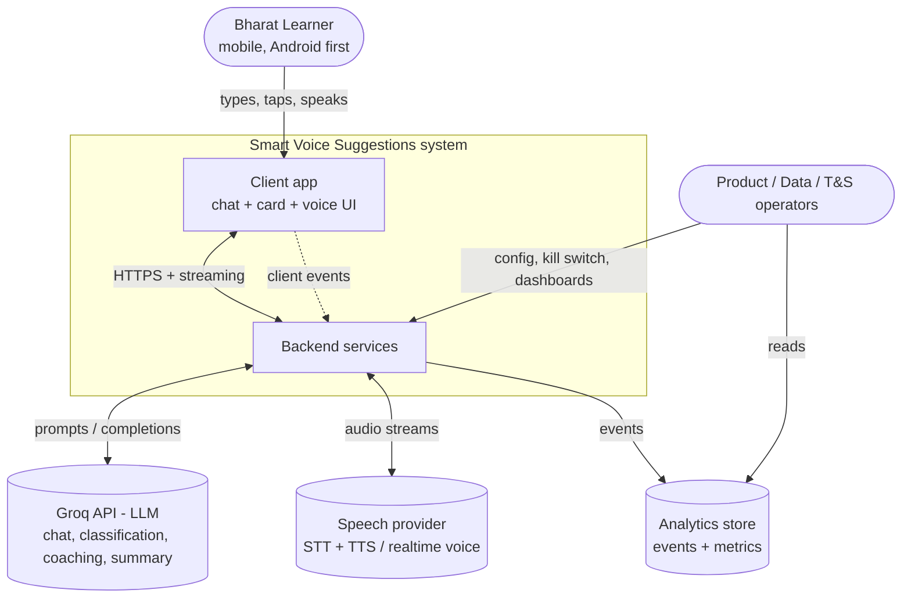
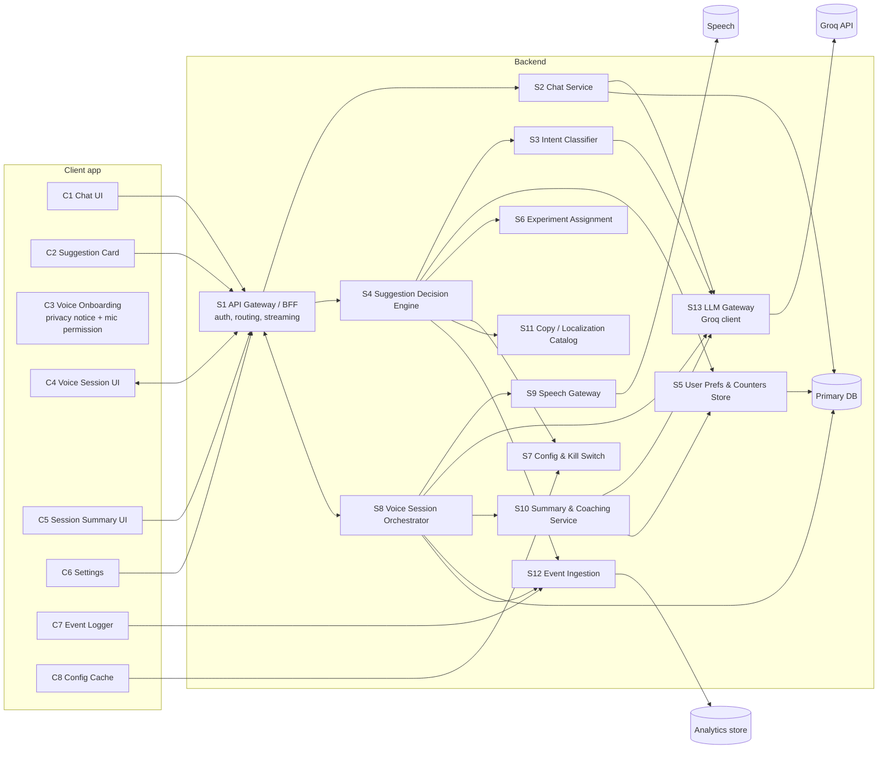
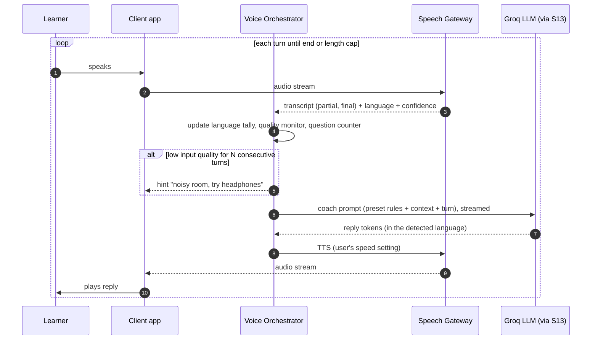
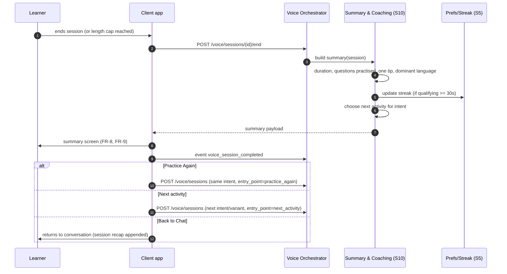
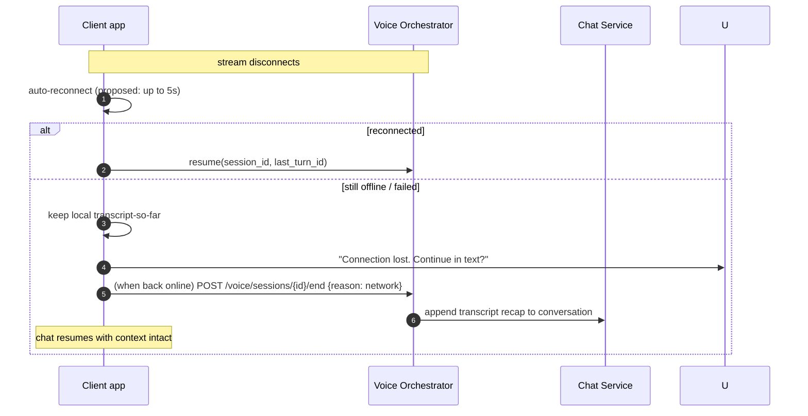
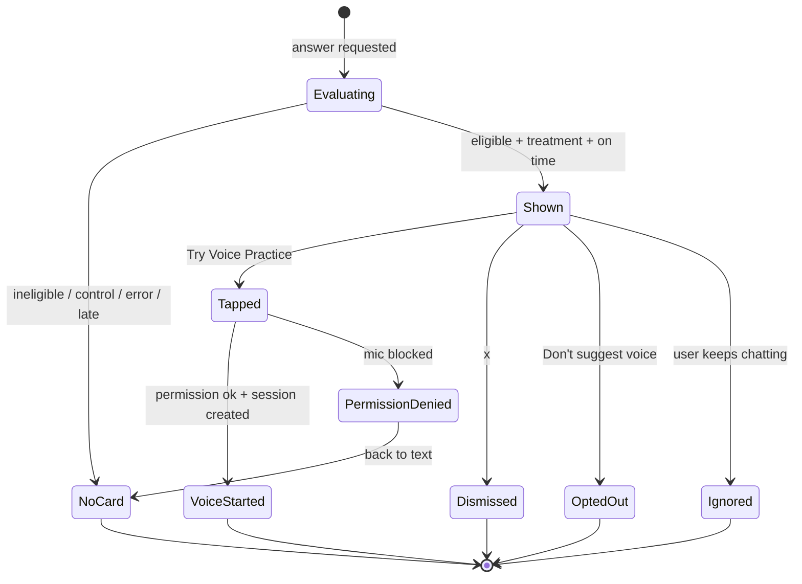
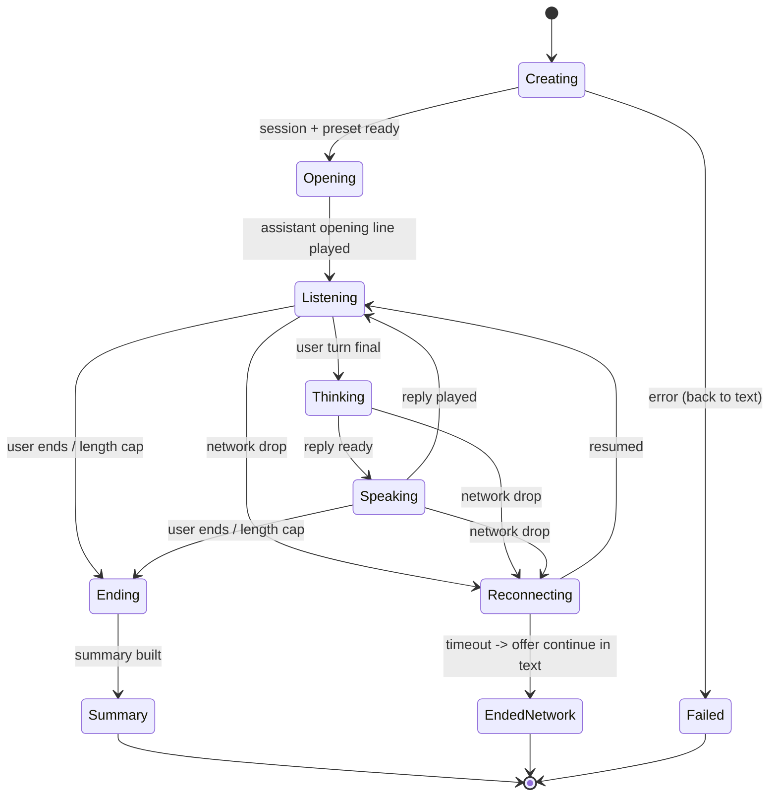
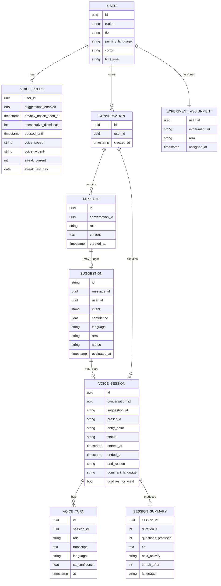

# Architecture: Smart Voice Suggestions MVP

> Derived from [context.md](context.md), which consolidates Milestone 1, Milestone 2 and the PRD.
>
> **Stack status:**
> - **LLM provider: decided. Groq** (GroqCloud API) serves every LLM call: chat answers, intent classification, in-session coaching and the session summary. See [§6.7 LLM integration (Groq)](#67-llm-integration-groq).
> - **Stack: decided in Phase 0** ([decisions.md](decisions.md)):
>   - client: responsive website, React + Vite + TypeScript, desktop and mobile views
>   - backend: Node.js + TypeScript (Fastify)
>   - database: PostgreSQL
>   - speech: **Groq Whisper STT + browser TTS** (see [§6.8](#68-speech-integration-groq-whisper--browser-tts))
> - **Still open:** hosting (ADR-009) and authentication (ADR-010).
>
> This document describes the **logical architecture**: components, responsibilities, contracts, data, flows and rules. Wherever a choice depends on the stack, it is listed under [§17 Open decisions](#17-open-decisions).
>
> **Notation:** requirement IDs (FR-x) and constants come from the PRD. Anything marked **(proposed)** is an engineering default added here because the PRD leaves it unspecified. Confirm or change those before building.

---

## Table of contents
1. [Goals and architectural drivers](#1-goals-and-architectural-drivers)
2. [System context](#2-system-context)
3. [Container / component view](#3-container--component-view)
4. [Design principles](#4-design-principles)
5. [Key flows (sequence diagrams)](#5-key-flows-sequence-diagrams)
6. [Component specifications](#6-component-specifications)
7. [State machines](#7-state-machines)
8. [Data model](#8-data-model)
9. [API contracts](#9-api-contracts)
10. [Configuration, feature flags and kill switch](#10-configuration-feature-flags-and-kill-switch)
11. [Experimentation architecture](#11-experimentation-architecture)
12. [Analytics and metrics pipeline](#12-analytics-and-metrics-pipeline)
13. [Non-functional architecture](#13-non-functional-architecture)
14. [Failure modes and degradation](#14-failure-modes-and-degradation)
15. [Rollout and environments](#15-rollout-and-environments)
16. [Testing strategy](#16-testing-strategy)
17. [Open decisions](#17-open-decisions)
18. [Traceability matrix](#18-traceability-matrix)

---

## 1. Goals and architectural drivers

### 1.1 What the system does
In a ChatGPT-style text chat for Bharat Learners (18–24, Tier-2/3, regional-language first), the system:
1. answers the typed query as normal (text is **always first, never blocked**),
2. classifies whether the query is a **voice-friendly learning task** (mock interview, spoken English, viva/oral revision, pronunciation),
3. when it is, the user is eligible and the user is in the treatment arm, shows a **Smart Voice Suggestion card** below the answer,
4. on one tap, opens a **task-preset voice session** that carries the chat context, with the **assistant speaking first**,
5. ends with a **session summary** (duration, questions practised, tip, streak, next activity) to close the habit loop,
6. logs every step so **WAVL, voice start rate and D7 voice retention** can be measured in an A/B test.

### 1.2 Architectural drivers (ranked)
| # | Driver | Source | Architectural consequence |
|---|---|---|---|
| D1 | Text answer is never delayed or blocked | FR-1, FR-2, NFR | Classification runs **in parallel** with answer generation; the card is a **separate, optional, late** payload |
| D2 | Fail safe: on any failure, hide the card and keep text chat working | NFR | Every suggestion path is **fail-closed** (no card) and never throws into the chat path |
| D3 | Not pushy (71% prefer typing) | FR-4, FR-5, Risk #1 | **Server-side** frequency caps, dismiss/opt-out, pause logic, opt-out guardrail monitoring |
| D4 | Voice session starts in <2s on a mid-range Android phone over 4G | NFR | Pre-warm on card render, small opening payload, streaming speech, preset prompt resolved server-side |
| D5 | Remote control without an app release | NFR | **Server-evaluated** config + kill switch by region / language / cohort |
| D6 | Measurable, unbiased experiment | Experiment plan | User-level deterministic assignment; **eligibility computed identically in both arms**; events tagged with intent, language, arm |
| D7 | Privacy: no new data collection | FR-6, NFR, DPDP | Reuse the existing Voice Mode policy; **no audio storage**; event payloads carry no query text or PII |
| D8 | Accessibility | NFR | Card and voice UI meet WCAG AA and work with TalkBack / VoiceOver |
| D9 | Cost control | Risk #4 | Session length cap, cost per WAVL tracking, kill switch |

### 1.3 Out of scope (architecture will not include)
Speech/accent model changes, new voices, translation, pricing/paywall changes, other segments, Voice Preview Mode, Voice Learning Challenges, whisper mode (all non-goals or v2).

---

## 2. System context



| Actor / system | Role |
|---|---|
| Bharat Learner | Types study queries, taps the card, speaks in voice sessions |
| Client app | Renders chat, card, privacy notice, mic-permission handling, voice session, summary, settings |
| Backend | Chat, classification, suggestion decisions, voice orchestration, summaries, config, experiment, events |
| **Groq API (LLM)** | Text answers, intent classification, in-session coaching replies, summary tip and next activity. OpenAI-compatible Chat Completions API, called **only from the backend** |
| Speech provider | Speech-to-text (with language detection) and text-to-speech, or a realtime voice API |
| Analytics store | Raw events plus derived metrics for the A/B test and guardrails |
| Operators | Flip the kill switch, change thresholds and copy, watch dashboards |

---

## 3. Container / component view



### 3.1 Component responsibilities

| ID | Component | Responsibilities | Key FRs |
|---|---|---|---|
| C1 | Chat UI | Send queries, render streamed text answer, host the card slot below the answer, thumbs up/down | FR-2 |
| C2 | Suggestion Card | Render title, why-voice line, optional headphone hint, **Try Voice Practice**, dismiss (×), "Don't suggest voice"; accessible announcement | FR-2, FR-4, FR-11 |
| C3 | Voice Onboarding | First-use privacy line + policy link; mic permission request; denied-permission explainer with settings deep link and return to text | FR-6, FR-7 |
| C4 | Voice Session UI | Task label, assistant-first playback, live state (listening/thinking/speaking), speed and accent controls one tap away, noisy-room hint, end button, network-drop handling | FR-3, FR-10 |
| C5 | Session Summary UI | Duration, questions practised, one tip, streak progress, Practice Again, Back to Chat, next activity | FR-8, FR-9 |
| C6 | Settings | Toggle to turn voice suggestions back on (or off) | FR-4 |
| C7 | Event Logger | Batched, retried client events with standard envelope | Instrumentation |
| C8 | Config Cache | Short-TTL cache of client-relevant config (copy, UI flags). **Never** the authority for the kill switch | NFR control |
| S1 | API Gateway / BFF | Auth, rate limiting, request fan-out, multiplexes answer stream + late suggestion event | D1 |
| S2 | Chat Service | Generates the normal text answer (streaming), persists messages | — |
| S3 | Intent Classifier | `classify(query, context) → {intent, confidence, language}` under a strict time budget | FR-1 |
| S4 | Suggestion Decision Engine | Applies the full eligibility pipeline (prefs, kill switch, caps, pause, arm, threshold), selects localized copy, records impressions | FR-2, FR-4, FR-5 |
| S5 | User Prefs & Counters | Opt-out flag, privacy-notice-seen flag, per-conversation / weekly impression counters, consecutive-dismissal counter, pause-until, streak state, speed/accent prefs | FR-4, FR-5, FR-6, FR-8, FR-10 |
| S6 | Experiment Assignment | Deterministic user-level 50/50 arm; exposure logging | Experiment |
| S7 | Config & Kill Switch | Thresholds, caps, rollout %, kill switch scoped by region / language / cohort; hot-reloadable | NFR control |
| S8 | Voice Session Orchestrator | Creates sessions from task presets, builds context (preset + recent chat), runs the turn loop, language tracking, quality signals, length cap, transcript persistence per policy | FR-3, edge cases |
| S9 | Speech Gateway | Provider-agnostic adapter for STT (with language ID and confidence); hides the vendor. **MVP: Groq Whisper STT only. TTS runs in the browser (C4)**, see §6.8 | FR-3, FR-10 |
| S10 | Summary & Coaching | Computes duration and question count, generates one improvement tip, updates the streak, picks the next activity, writes in the dominant language | FR-8, FR-9 |
| S11 | Copy / Localization Catalog | Card titles, why-voice lines, hints, privacy line, per intent × language (en, hi, then top 3 regional) | FR-2, FR-11 |
| S12 | Event Ingestion | Validates and enriches events (arm, cohort), forwards them to the analytics store | Instrumentation |
| S13 | LLM Gateway (Groq client) | Single place that calls Groq. Handles model selection per use case, timeouts, retries/backoff on 429/5xx, fallback model, structured-output validation, token/cost metering and the API key | FR-1, FR-3, FR-8, NFR |

---

## 4. Design principles

1. **Text-first, suggestion-later.** The answer stream and the suggestion decision are independent. The suggestion is attached only **after** the answer completes. If the decision isn't ready within a short grace window, no card is shown for that turn.
2. **Fail closed for suggestions, fail open for chat.** Any error, timeout or missing config in S3, S4, S5, S6 or S7 means **no card**. The chat path never depends on those services.
3. **Server is authoritative** for eligibility, caps, kill switch and arm. The client only renders what it receives, which keeps behaviour consistent and lets operators change it without a release.
4. **Cheap checks before expensive ones.** Opt-out, kill switch, pause and caps are evaluated **before** the classifier runs, which saves cost and latency.
5. **Same eligibility in both arms.** Control users go through the identical pipeline (including the classifier and caps) but are never shown a card. This keeps the "eligible users" denominator unbiased.
6. **Presets are data, not code.** Each intent maps to a preset (label, opening line, coaching instructions, next-activity options) stored in config, so presets can be tuned without a deploy.
7. **Privacy by reuse.** Nothing beyond the existing Voice Mode policy: no raw audio stored; transcripts handled exactly as Voice Mode already handles them; analytics events carry IDs and enums, never query text.
8. **One gateway per vendor.** All Groq calls go through S13, and all speech calls go through S9. Model IDs live in config, not code, so a Groq model can be swapped or deprecated without changing the services that use it.

---

## 5. Key flows (sequence diagrams)

### 5.1 Typed query → text answer → (maybe) suggestion card
```mermaid
sequenceDiagram
    autonumber
    participant U as Learner
    participant A as Client app
    participant B as BFF (S1)
    participant C as Chat Service (S2)
    participant D as Decision Engine (S4)
    participant K as Classifier (S3)
    participant P as Prefs/Counters (S5)
    participant X as Experiment (S6)
    participant F as Config (S7)

    U->>A: types query, sends
    A->>B: POST /chat/messages (stream)
    par Answer path (never waits on suggestions)
        B->>C: generate answer
        C-->>B: token stream
        B-->>A: answer tokens (rendered immediately)
    and Suggestion path (fail-closed)
        B->>D: evaluate(user, conversation, query)
        D->>F: kill switch / config for region, language, cohort
        D->>P: opt-out? paused? caps reached?
        D->>X: arm(user)
        alt any pre-check fails
            D-->>B: no_suggestion(reason)
        else pre-checks pass
            D->>K: classify(query, recent turns) [time budget]
            K-->>D: intent, confidence, language
            alt intent == none or confidence < threshold or error/timeout
                D-->>B: no_suggestion(reason)
            else eligible
                D->>P: record impression (conv + weekly counters)
                D-->>B: eligible(intent, arm, copy, suggestion_id)
            end
        end
    end
    B-->>A: answer_complete
    alt eligible AND arm == treatment AND decision arrived within grace window
        B-->>A: suggestion event (card payload)
        A->>U: card rendered below answer
        A->>B: event suggestion_shown
    else control arm or not eligible or late
        Note over A: no card; user continues typing
    end
```

Notes:
- `suggestion_eligible` is logged by S4 for **both** arms. `suggestion_shown` is logged by the client only when the card is actually rendered and visible.
- **Grace window (proposed):** 500 ms after `answer_complete`. If the decision misses it, drop the card for this turn and log `reason=late`.

### 5.2 Tap card → privacy notice → mic permission → voice session start
```mermaid
sequenceDiagram
    autonumber
    participant U as Learner
    participant A as Client app
    participant B as BFF
    participant V as Voice Orchestrator (S8)
    participant P as Prefs (S5)
    participant S as Speech Gateway (S9)

    U->>A: taps "Try Voice Practice"
    A->>B: event suggestion_tapped
    A->>P: privacy_notice_seen?
    alt first voice use
        A->>U: privacy line + policy link (FR-6)
        U->>A: continue
        A->>P: mark privacy_notice_seen
    end
    A->>A: check / request mic permission
    alt permission denied or blocked
        A->>U: why mic is needed + "Open settings" + "Back to text" (FR-7)
        A->>B: event mic_permission_denied
        Note over A: returns to chat, no dead end
    else granted
        A->>B: POST /voice/sessions {conversation_id, intent, suggestion_id, entry_point}
        B->>V: create session
        V->>V: load preset(intent) + recent chat context + user speed/accent prefs
        V->>S: open stream, synthesize opening line
        V-->>A: session_id, stream endpoint, task label, opening prompt
        A->>U: "Interview Practice" screen; assistant speaks first (FR-3)
        A->>B: event voice_session_started
    end
```

**Start-latency budget (<2s, proposed breakdown)**, measured from session request (after permission) to the first audible assistant audio:
| Step | Budget |
|---|---|
| Session create + preset/context load | ≤300 ms |
| Stream connect | ≤400 ms |
| Opening line TTS, first audio chunk | ≤800 ms |
| Network / render slack | ≤500 ms |

To hit it: pre-warm on card render (pre-resolve the preset, optionally pre-synthesize the opening line), stream TTS, and keep the opening line short.

### 5.3 In-session turn loop


### 5.4 Session end → summary → next step


### 5.5 Dismiss / opt-out
```mermaid
sequenceDiagram
    autonumber
    participant U as Learner
    participant A as Client app
    participant B as BFF
    participant P as Prefs/Counters

    alt taps dismiss (x)
        U->>A: dismiss
        A->>B: POST /suggestions/{id}/dismiss
        B->>P: consecutive_dismissals += 1
        alt consecutive_dismissals >= 3
            B->>P: paused_until = now + 14 days; reset counter
        end
        A->>B: event suggestion_dismissed
    else taps "Don't suggest voice"
        U->>A: opt out
        A->>B: PUT /me/voice-preferences {suggestions_enabled: false}
        B->>P: opt-out (effective immediately)
        A->>B: event suggestions_opted_out
    end
    Note over P: re-enable from Settings (C6) sets suggestions_enabled = true
```

**Consecutive-dismissal semantics (proposed):** the counter increments on dismiss and **resets to 0 on tap** (and when a pause starts). A card that is ignored (neither tapped nor dismissed) does not change it.

### 5.6 Network drop during a voice session


---

## 6. Component specifications

### 6.1 S3 Intent Classifier
**Interface**
```
classify(input) -> output
input:  { query: string, recent_turns: [{role, text}] (max 2, proposed), locale_hint?: string }
output: { intent: "mock_interview" | "spoken_english" | "viva_revision" | "pronunciation" | "none",
          confidence: float 0..1,
          language: "en" | "hinglish" | "hi" | "other",
          model_version: string,
          latency_ms: int }
```
**Requirements**
- Precision ≥85% on a labelled set of ≥1,000 Indian learner queries (English + Hinglish) (FR-1). **Precision** is the gate, because a false card is the pushy failure mode.
- Runs inside a **hard time budget** (proposed: finish no later than `answer_complete` + grace window). On timeout, return `none`.
- **Per-intent thresholds** in config, tuned on the eval set to hit the precision target.
- Ambiguous queries (e.g. "explain interview questions for testers") fall below the threshold, so no card is shown.

**Implementation options** (the LLM is Groq; the classifier pattern is still open, see §17)
| Option | Pros | Cons |
|---|---|---|
| A. Groq LLM classification on every query: `openai/gpt-oss-20b` with **strict `json_schema`** output (few-shot) | Fastest to build; handles Hinglish; schema-valid output guaranteed | A Groq call on every eligible query; counts against rate limits |
| B. Keyword/rule prefilter → Groq classification only on candidates | Cuts Groq calls and cost; most queries skip the LLM | Rules need maintenance; recall depends on the prefilter |
| C. Small fine-tuned / embedding classifier (self-hosted) | Lowest latency and cost at scale | Needs labelled data and a training pipeline; leaves Groq for this step |

Recommended path: start with **B** (rules prefilter + Groq `openai/gpt-oss-20b`, strict JSON schema, non-streaming) for the MVP. Collect labels from dogfood, then move to **C** only if cost or latency requires it.

**Groq request shape for classification** (see §6.7 for shared gateway rules):
```jsonc
// POST https://api.groq.com/openai/v1/chat/completions  (via S13)
{
  "model": "openai/gpt-oss-20b",                 // config: svs.llm.model.classifier
  "temperature": 0,
  "max_completion_tokens": 200,
  "messages": [
    { "role": "system", "content": "<classifier instructions + few-shot English/Hinglish examples>" },
    { "role": "user",   "content": "<query + up to 2 recent turns>" }
  ],
  "response_format": {
    "type": "json_schema",
    "json_schema": {
      "name": "voice_intent",
      "strict": true,
      "schema": {
        "type": "object",
        "additionalProperties": false,
        "required": ["intent", "confidence", "language"],
        "properties": {
          "intent":     { "type": "string", "enum": ["mock_interview", "spoken_english", "viva_revision", "pronunciation", "none"] },
          "confidence": { "type": "number" },
          "language":   { "type": "string", "enum": ["en", "hinglish", "hi", "other"] }
        }
      }
    }
  }
}
```
- The model returns `confidence` as a number. Calibrate it against the eval set (threshold sweep) instead of trusting it as a raw probability.
- `model_version` in the classifier output is the Groq model ID plus the prompt version (e.g. `openai/gpt-oss-20b@prompt-v3`), so every eval result and `suggestion_eligible` event can be traced to the exact model and prompt.

**Eval harness:** versioned labelled dataset, per-intent precision/recall, a confusion matrix, and a threshold sweep. It runs in CI on every classifier or prompt change and is a **launch gate** for dogfood.

**As built (Phase 2, see docs/phase2/README.md):**
- Option B: prefilter `pf-v1` + prompt `clf-v2` on `openai/gpt-oss-20b`, with fallback `openai/gpt-oss-120b`.
- Thresholds live in `packages/shared/src/classifier-thresholds.json`: mock_interview 0.5, spoken_english 0.5, viva_revision 0.96, pronunciation 0.5.
- Timeout is 2 s.
- Live eval writes cached predictions; the CI gate (`npm run eval:check`) re-scores them offline and fails on stale predictions, precision <85% or any ambiguous card.
- Model confidence turned out to be narrow (0.94–0.98), so precision comes mainly from the label.

### 6.2 S4 Suggestion Decision Engine
**Pipeline** (ordered cheapest-first; any failure → `no_suggestion(reason)`):
```
1. config = S7.resolve(region, language, cohort)
   if config.kill_switch_active                      -> no (kill_switch)
2. prefs = S5.get(user)
   if !prefs.suggestions_enabled                     -> no (opted_out)
   if prefs.paused_until > now                       -> no (paused)
   if counters.conversation_impressions(conv) >= 1   -> no (conv_cap)
   if counters.weekly_impressions(user) >= 3         -> no (weekly_cap)
3. arm = S6.assign(user)                              # deterministic
4. result = S3.classify(query, recent_turns)          # time-boxed
   if error/timeout                                   -> no (classifier_error)
   if result.intent == none                           -> no (not_voice_friendly)
   if result.confidence < config.threshold[intent]    -> no (low_confidence)
5. log suggestion_eligible {intent, language, arm, confidence}
6. record impression in counters (both arms; control = shadow impression)
7. if arm == control                                  -> no (control_arm)
8. copy = S11.get(intent, ui_language, variant)
9. return eligible {suggestion_id, intent, preset_id, copy}
```
- **Idempotency:** `suggestion_id` is derived from `(conversation_id, message_id)`, so retries don't double-count impressions.
- **Weekly window:** a rolling 7×24h window in absolute time, so time zones don't affect it (decisions.md ADR-008). Local time matters only for streak days.
- **Reason codes** for every `no` are emitted to metrics (not as user-facing events) for funnel debugging.

### 6.3 S5 User Prefs & Counters
| Field | Type | Purpose |
|---|---|---|
| `suggestions_enabled` | bool (default true) | FR-4 opt-out; reversible in Settings |
| `privacy_notice_seen_at` | timestamp? | FR-6 first-use notice |
| `consecutive_dismissals` | int | FR-5 pause trigger |
| `paused_until` | timestamp? | FR-5 14-day pause |
| `impressions` | list of `(timestamp, conversation_id, arm)` | Per-conversation and weekly caps |
| `voice_speed` | enum/float | FR-10 |
| `voice_accent` | enum | FR-10 (meaning to be confirmed, see §17) |
| `streak_current`, `streak_last_day` | int, date | FR-8 streak |

Requirements: strongly consistent per user, so that two concurrent tabs can't both exceed the cap (use an atomic increment / compare-and-set). Read latency is in the low milliseconds; a key-value store or a primary-DB row with a cache both work.

### 6.4 S8 Voice Session Orchestrator
**Task presets (config-driven)**
| `preset_id` | Intent | Session label | Opening behaviour (assistant speaks first) | Next-activity options |
|---|---|---|---|---|
| `interview_practice` | mock_interview | Interview Practice | Asks the first interview question, using the role/topic from the chat if present | HR questions, technical round, follow-ups |
| `spoken_english` | spoken_english | Spoken English Practice | Starts a short conversation prompt; corrects gently | Topic conversation, describe-a-picture, daily-life roleplay |
| `viva_revision` | viva_revision | Viva / Oral Revision | Asks the learner to explain the concept from the chat, then asks questions back | Related concept, rapid-fire questions |
| `pronunciation` | pronunciation | Pronunciation Practice | Gives a word or phrase to say aloud and gives feedback | Next word set, sentence-level practice |

(Labels and openings follow the PRD examples; the next-activity lists are **proposed**.)

**Context carry-over (FR-3):** at session creation, load the preset's system instructions plus the **last N turns** of the conversation (proposed N=6) or a short summary of them. The opening line must reference the user's actual topic, so they don't repeat themselves.

**Language handling (edge case):** STT language ID per final transcript. The reply language follows the latest user turn; a per-language turn tally decides the **summary language** (the language spoken most).

**Quality monitor (edge case):** if STT confidence or audio-quality signals stay below a threshold for N consecutive turns (proposed N=2), emit `noisy_room_hint`. The UI shows it non-modally.

**Speed and accent controls (FR-10):** sent as session settings updates. Speed maps to the TTS rate. Accent maps to the TTS voice/locale and/or the STT locale hint (en-IN / hi-IN), to be decided in §17. Changes apply from the next turn and persist to S5.

**Length cap (Risk #4):** a configurable max session duration (proposed 10 min). Warn 1 minute before; on reaching the cap, end gracefully and go to the summary.

**Transcript handling:** finalized turns are persisted **only as the existing Voice Mode policy allows**. Raw audio is never stored by this feature. Finalized turns are what makes "continue in text without losing context" possible after a network drop.

### 6.5 S10 Summary & Coaching
| Output | Computation |
|---|---|
| Duration | `ended_at − started_at` (excluding reconnect gaps) |
| Questions practised | Count of assistant question turns followed by a user answer turn |
| One improvement tip | A single Groq call (`svs.llm.model.summary`, strict `json_schema`, non-streaming) over the transcript with the preset's rubric (confidence, accuracy, fluency); returns exactly **one** actionable tip and the chosen next activity |
| Streak progress | Proposed: consecutive local days with ≥1 qualifying session (≥30s on a learning task), shown against a goal (proposed 3 days) |
| Next activity | One option from the preset's next-activity list (FR-9) |
| Language | The dominant spoken language of the session |

A session of **≥30s** with a learning intent counts toward WAVL. The flag `qualifies_for_wavl` is stored on the session.

### 6.6 S11 Copy / Localization Catalog
- Key: `(intent, ui_language, variant)` → `{title, why_line, cta, dismiss_label, opt_out_label, headphone_hint}`.
- Default copy follows the PRD: **"Practice with Voice"**, with the why-line "speak your answers out loud and get instant feedback on your confidence and accuracy" and the CTA **"Try Voice Practice"**. Titles are task-specific per intent (FR-2).
- Rollout: English (+ Hinglish-friendly English) → Hindi → top 3 regional languages by segment usage (FR-11; ramp phase).
- The privacy line and mic-permission explainer strings live here too, and need Legal / T&S approval before dogfood.

### 6.7 LLM integration (Groq)

**Decision:** Groq is the only LLM provider. Every LLM call goes through **S13 LLM Gateway**, which calls the GroqCloud **OpenAI-compatible Chat Completions API** (`https://api.groq.com/openai/v1/chat/completions`) from the backend. The client app never talks to Groq directly.

#### 6.7.1 Model mapping (proposed; model IDs live in config)
Only Groq **production** models are used on core paths. Groq's own docs say preview models are for evaluation only and may be discontinued at short notice.

| Use case | Caller | Proposed model | Fallback model | Call style | Why |
|---|---|---|---|---|---|
| Text chat answer | S2 | `openai/gpt-oss-120b` (reasoning effort low) | `openai/gpt-oss-20b` | Streaming, plain text | Best quality available to the key; low reasoning effort keeps time-to-first-token short |
| Intent classification (FR-1) | S3 | `openai/gpt-oss-20b` (reasoning effort low) | `openai/gpt-oss-120b` | Non-streaming, **strict `json_schema`** (both models support it) | Small, fast, schema-valid output; temperature 0 |
| In-session coach replies (FR-3) | S8 | `openai/gpt-oss-120b` (reasoning effort low) | `openai/gpt-oss-20b` | **Streaming**, plain text (sent sentence by sentence to TTS) | Turn latency matters most; streaming lets TTS start early |
| Opening line for a preset (FR-3) | S8 | `openai/gpt-oss-20b` (reasoning effort low) | Static template from the preset | Non-streaming, short | Must fit the <2s start budget; template fallback guarantees the assistant speaks first |
| Session summary: tip + next activity (FR-8, FR-9) | S10 | `openai/gpt-oss-120b` | `openai/gpt-oss-20b` | Non-streaming, **strict `json_schema`** | Higher-quality feedback; not latency-critical |

Model availability on Groq changes over time, and it also depends on the account tier. **The Llama models originally proposed (`llama-3.3-70b-versatile`, `llama-3.1-8b-instant`) are Enterprise-tier and not available to the project key** (checked 2026-11-16 with `npm run groq:check`), so every use case now runs on the two production `gpt-oss` models. **Re-run `npm run groq:check` before the build and at each phase gate**, and keep model IDs as config values (§10).

**gpt-oss is a reasoning model.** It thinks before producing visible output. Set `reasoning_effort` per use case (`svs.llm.reasoning_effort.*`: low for chat, classifier, coach and opening; medium for summary). Don't stream or store the reasoning text: ask Groq to hide it, or drop it in S13. Phase 1 must measure TTFT with low effort against the "text never slower" baseline.

#### 6.7.2 Groq constraints that shape the design
| Constraint | Design response |
|---|---|
| Structured outputs (`json_schema`) **cannot be combined with streaming or tool use** on Groq | Classifier and summary are **non-streaming** JSON-schema calls. Chat answer and coach replies are **streaming plain text**. Nothing in the MVP needs tool use |
| Strict mode requires every property in `required` and `additionalProperties: false` (optional fields as nullable types) | All schemas in this doc follow that rule (see §6.1) |
| Best-effort JSON (`strict: false` / `json_object`) can produce invalid output or an HTTP 400 on schema mismatch | Fallback paths validate server-side; an invalid result counts as a classifier error, which means **no card** (fail closed) |
| Organisation-level rate limits (requests and tokens per minute/day) return **HTTP 429** | S13 honours `retry-after`, uses jittered backoff, and has **separate concurrency budgets per use case** so classification bursts can never starve chat answers |
| Preview models can disappear at short notice | Core paths use production models only; model IDs in config; fallback model per use case |

#### 6.7.3 Gateway behaviour (S13)
- **Timeouts per use case (proposed):** classifier = `svs.classifier.timeout_ms` (2s, raised from 1.5s in Phase 2); opening line 600 ms, then the static template; coach first token 1s; summary 8s; chat answer uses the normal chat timeout.
- **Retries:** at most 1 retry for non-streaming calls, and only within the caller's time budget. **No retries** on the classifier once it has passed the grace window, because the card would arrive late anyway. Streaming calls are not retried after the first token has been sent.
- **Fallback:** on timeout, 429 or 5xx from the primary model, use that use case's fallback model once. If that also fails:
  - classifier: no card
  - opening line: static template
  - coach reply: a short "Sorry, can you say that again?" turn
  - summary: show duration and question count only, without a tip
  - chat answer: the normal chat error state
- **Prompt management:** system prompts (classifier, each preset's coach, summary rubric) are versioned files or config entries. Each call records `model_id` and `prompt_version`.
- **Metering:** record `usage` (prompt and completion tokens) per call, tagged by use case, `session_id` and `arm`. This feeds **cost per WAVL** (§12.3) and the ramp gate.
- **Secrets:** `GROQ_API_KEY` lives only in the backend secret store / environment. It is never shipped to the client and never logged.

#### 6.7.4 Privacy note for Groq
Query text, recent chat turns, voice transcripts and **short audio clips (for Whisper STT, §6.8)** are sent to Groq for processing. This must stay inside the PRD rule of **"no new data collection beyond the current Voice Mode policy"** and DPDP notice and consent. Before dogfood, Legal / T&S must confirm that Groq's data-processing and retention terms are acceptable (see §17 and docs/phase0/legal-review.md). Analytics events still carry **no** query or transcript text.

### 6.8 Speech integration (Groq Whisper + browser TTS)
Decided in Phase 0 (decisions.md ADR-005). Where this section differs from the generic speech flows in §5.2/§5.3, **this section wins**.

| Function | Where | How |
|---|---|---|
| Capture | Browser (C4) | `getUserMedia` + `MediaRecorder` (Opus/WebM). End of turn = 1.2s of silence (client-side detector) **or** the "Done" button |
| Speech-to-text | Server (S9) → Groq | `whisper-large-v3-turbo` (fallback `whisper-large-v3`), `response_format=verbose_json` → text, detected `language`, per-segment `avg_logprob` and `no_speech_prob` |
| Quality signal | S8 | Low `avg_logprob` / high `no_speech_prob` on N=2 consecutive turns → `hint.noisy_room` (thresholds tuned in Phase 4) |
| Language | S8 | Whisper `language` + script check. `hi` written in Latin script counts as `hinglish`. A romanized-Hinglish `prompt` hint biases Whisper toward Latin script |
| Coach reply | S8 → Groq (streaming) → client | The server streams reply **text** over the voice WebSocket, sentence by sentence |
| Text-to-speech | Browser (C4) | `speechSynthesis` with an `en-IN` or `hi-IN` voice. **Speed** = `utterance.rate`, **accent** = voice choice. If a `hi-IN` voice is missing, fall back to an English voice. Captions are always shown |
| Opening line | S8 → client | Text is sent in the session-create response; the browser speaks it at once (no TTS network hop), which protects the <2s start budget |

Consequences:
- No audio leaves our server except to Groq Whisper, and no audio is stored.
- TTS quality depends on the device; captions guarantee the reply is always readable.
- The WebSocket carries **audio clips up** (one per turn) and **text + events down** (`transcript.final`, `reply.delta`, `reply.done`, `hint.noisy_room`, `limit.warning`, `session.ending`).

**As built (Phase 4, see docs/phase4/README.md and decisions.md ADR-012):** the protocol types live in `packages/shared/src/voice.ts`.
- Client → server: a `{type:"turn", mime}` message then one binary clip per turn, plus `settings`, `metrics` (start latency), `pause`/`resume` and `end`.
- Server → client: `ready` (with missed turns on resume), `transcript.final` / `transcript.empty`, `reply.sentence`, `reply.done`, `hint.noisy_room`, `limit.warning`, `busy`, `error`, `session.ended` (stats).
- REST: `POST /v1/voice/sessions`, `POST …/:id/end`, `POST …/:id/continue-in-text`. The separate `PATCH …/settings` from §9.3 is replaced by the WS `settings` message plus `PUT /v1/me/voice-preferences`.
- Live on Groq: create 0.34–0.63 s (LLM opening), Whisper ~0.3–0.85 s per turn, first coach sentence 0.67–1.37 s after the clip.

**Summary and streak, as built (Phase 5, see docs/phase5/README.md and decisions.md ADR-013):**
- `GET /v1/voice/sessions/:id/summary` (owner only; 409 while the session is still live) returns `SessionSummary`: duration, questions, one tip in the dominant language, next activity, streak and a short-session flag. It is built in the background as soon as the session ends and cached in `session_summaries`.
- `POST /v1/voice/sessions/:id/recap` (Back to Chat) appends one recap message; it is idempotent.
- `POST /v1/voice/sessions` accepts `entry_point: "next_activity"` plus `next_activity_index`, which becomes the session's focus.
- `session.ended` stats carry `streak {current, goal, credited}`.

---

## 7. State machines

### 7.1 Suggestion card (per answer)


### 7.2 Voice session


---

## 8. Data model



Notes:
- `SUGGESTION.status` ∈ `eligible_control | shown | tapped | dismissed | opted_out | ignored | late`.
- `VOICE_SESSION.entry_point` ∈ `suggestion_card | mic_button | practice_again | next_activity`. It separates suggestion-driven sessions from organic ones.
- `VOICE_TURN.transcript` exists only within the existing Voice Mode retention policy. **No audio column.**
- Impression counters can be derived from `SUGGESTION` rows (indexed by `user_id, evaluated_at`) or kept as counters in S5. Pick one source of truth.

---

## 9. API contracts
REST + streaming, shown as protocol-neutral JSON. Paths are illustrative.

### 9.1 Chat with a late suggestion event
`POST /v1/conversations/{conversation_id}/messages`, response streamed (SSE, WebSocket or chunked):
```jsonc
// request
{ "text": "Help me prepare for my TCS interview", "client_msg_id": "c-123" }

// stream events (in order). As built in Phase 1: see packages/shared/src/chat.ts
{ "type": "message.accepted", "user_message_id": "u-3", "replay": false }   // replay=true: resend of a finished client_msg_id
{ "type": "answer.delta", "message_id": "m-9", "text": "Sure! Here are..." }
{ "type": "answer.complete", "message_id": "m-9", "ttft_ms": 512 }
// …or instead of answer.complete:
// { "type": "answer.error", "message_id": "m-9", "code": "llm_unavailable" | "rate_limited" | "in_progress" | "internal", "retryable": true }
{ "type": "suggestion",                       // optional, only treatment + eligible + on time
  "suggestion_id": "s-conv1-m-9",
  "intent": "mock_interview",
  "preset_id": "interview_practice",
  "copy": {
    "title": "Practice with Voice",
    "why_line": "Speak your answers out loud and get instant feedback on your confidence and accuracy.",
    "cta": "Try Voice Practice",
    "headphone_hint": "Tip: use headphones in a shared space.",
    "opt_out_label": "Don't suggest voice"
  }
}
{ "type": "stream.end" }
```

**As built (Phase 3):** the `suggestion` event also carries `message_id` (the answer it sits under) and `preset_label`; `suggestion_id = sg_<message_id>`; `copy` comes from `packages/shared/src/copy.ts` and also includes `dismiss_label`. Stored messages return the same payload in `suggestion` (with `status`) while the card is still visible. Every decision writes a reason code to the `suggestion_decisions` table (docs/phase3/README.md).

### 9.2 Suggestion actions
| Method & path | Body | Effect |
|---|---|---|
| `POST /v1/suggestions/{id}/dismiss` | — | Increment consecutive dismissals; maybe start the 14-day pause |
| `POST /v1/suggestions/{id}/tap` | — | Reset consecutive dismissals; mark tapped |
| `GET /v1/me/voice-preferences` | — | Returns prefs (enabled, speed, accent, privacy_notice_seen) |
| `PUT /v1/me/voice-preferences` | `{ "suggestions_enabled": false }` etc. | Opt out / opt back in (immediate); speed/accent |
| `POST /v1/me/privacy-notice-ack` | — | Marks the first-use notice as seen |

### 9.3 Voice sessions
```jsonc
// POST /v1/voice/sessions
{ "conversation_id": "conv1", "suggestion_id": "s-conv1-m-9",
  "intent": "mock_interview", "entry_point": "suggestion_card" }
// 201
{ "session_id": "vs-77", "label": "Interview Practice",
  "stream": { "url": "wss://…/v1/voice/sessions/vs-77/stream", "token": "…" },
  "opening": { "text": "Let's start. Tell me about yourself…", "audio_ready": true },
  "settings": { "speed": "normal", "accent": "en-IN" },
  "limits": { "max_duration_s": 600 } }
```
| Method & path | Purpose |
|---|---|
| `WS /v1/voice/sessions/{id}/stream` | Bidirectional: client audio up; server sends `transcript.partial/final`, `reply.audio`, `hint.noisy_room`, `limit.warning`, `session.ending` |
| `PATCH /v1/voice/sessions/{id}/settings` | `{ "speed": "slow", "accent": "hi-IN" }` (FR-10) |
| `POST /v1/voice/sessions/{id}/resume` | `{ "last_turn_id": "…" }` after a reconnect |
| `POST /v1/voice/sessions/{id}/end` | `{ "reason": "user" \| "cap" \| "network" }` → returns the summary |
| `POST /v1/voice/sessions/{id}/continue-in-text` | Appends a transcript recap to the conversation |

Summary response:
```jsonc
{ "duration_s": 312, "questions_practised": 5,
  "tip": "Use one concrete example when describing your project.",
  "streak": { "current": 2, "goal": 3 },
  "next_activity": { "label": "Practise HR questions next", "preset_id": "interview_practice", "variant": "hr" },
  "language": "hinglish" }
```

### 9.4 Config and events
| Method & path | Purpose |
|---|---|
| `GET /v1/config/client` | Client-safe config (copy version, UI flags). Short TTL. **Not** authoritative for the kill switch |
| `POST /v1/events` | Batched client events (see §12) |

---

## 10. Configuration, feature flags and kill switch

| Key | Type | Default | Source |
|---|---|---|---|
| `svs.enabled` | bool | false → ramp | Launch plan |
| `svs.kill_switch` | rules `[ {region?, language?, cohort?} ]` | `[]` | NFR control |
| `svs.rollout_percent` | int | 0 → 10 → 50 → 100 | Launch plan |
| `svs.experiment_id` / `svs.split` | string / 50:50 | — | Experiment plan |
| `svs.cap.per_conversation` | int | 1 | FR-5 |
| `svs.cap.per_week` | int | 3 | FR-5 |
| `svs.pause.dismissals` | int | 3 | FR-5 |
| `svs.pause.days` | int | 14 | FR-5 |
| `svs.classifier.threshold.{intent}` | float | tuned on the eval set | FR-1 |
| `svs.classifier.timeout_ms` | int | 2000 (decided Phase 2; was 1500) | D1 |
| `svs.suggestion.grace_ms` | int | proposed 500 | D1 |
| `svs.voice.max_duration_s` | int | proposed 600 | Risk #4 |
| `svs.voice.noisy_turns` | int | proposed 2 | Edge case |
| `svs.copy.languages` | list | `[en]` → `[en, hi]` → `+3 regional` | FR-11 |
| `svs.presets` | JSON | see §6.4 | FR-3, FR-9 |
| `svs.llm.provider` | string | `groq` | Decision |
| `svs.llm.model.chat` / `.chat_fallback` | string | `openai/gpt-oss-120b` / `openai/gpt-oss-20b` | §6.7.1 |
| `svs.llm.model.classifier` / `.classifier_fallback` | string | `openai/gpt-oss-20b` / `openai/gpt-oss-120b` | §6.7.1 |
| `svs.llm.model.coach` / `.coach_fallback` | string | `openai/gpt-oss-120b` / `openai/gpt-oss-20b` | §6.7.1 |
| `svs.llm.model.opening` | string | `openai/gpt-oss-20b` (template fallback) | §6.7.1 |
| `svs.llm.reasoning_effort.{use_case}` | `low` / `medium` / `high` | low (summary: medium) | §6.7.1 |
| `svs.llm.model.summary` / `.summary_fallback` | string | `openai/gpt-oss-120b` / `openai/gpt-oss-20b` | §6.7.1 |
| `svs.llm.timeout_ms.{use_case}` | int | see §6.7.3 | §6.7.3 |
| `svs.llm.concurrency.{use_case}` | int | set from Groq org rate limits | §6.7.2 |
| `svs.llm.prompt_version.{use_case}` | string | e.g. `classifier-v1` | §6.7.3 |

**Evaluation order:** `svs.enabled` → `svs.kill_switch` → `svs.rollout_percent` → the S4 pipeline.
Config is hot-reloaded server-side (target: effective within ≤1 minute, proposed). Every change is audited (who, when, old → new).

---

## 11. Experimentation architecture

- **Unit:** user. **Split:** 50/50 Control (no card) vs Treatment, **deterministic hash** of `(user_id, experiment_id)`, so a user always lands in the same arm across devices and sessions.
- **Population filter:** India, age 18–24, Tier-2/3 regions, and ≥1 **eligible** learning query. The filter is applied in analysis via `suggestion_eligible` events (both arms).
- **Symmetric eligibility:** control runs the same pipeline, including the classifier and caps (shadow impressions), so "eligible user" means the same thing in both arms. This removes the denominator bias the PRD warns about.
- **Exposure:** `suggestion_eligible` marks the first exposure-eligible moment. `suggestion_shown` marks actual treatment exposure.
- **Duration and power:** 4 weeks; detect a 2 pp lift in voice start rate at α=0.05, power 0.8. Run a **2-week pre-period** for baselines first.
- **Decision rules** (encoded in the analysis notebook/dashboard):
  - **Ship:** voice start rate ↑ AND D7 voice retention ↑ AND guardrails hold.
  - **Iterate:** taps ↑ but D7 flat → fix the in-session experience.
  - **Kill:** opt-out >5% OR text satisfaction drops.

**Two start-rate views (both are needed):**
| View | Formula | Use |
|---|---|---|
| Card-level start rate (treatment only) | voice sessions from `entry_point=suggestion_card` ÷ `suggestion_shown` | PRD target ≥15% |
| Eligible-user start rate (both arms) | users with ≥1 voice session in window ÷ users with ≥1 `suggestion_eligible` | Primary A/B comparison |

---

## 12. Analytics and metrics pipeline

### 12.1 Event envelope
```jsonc
{ "event": "suggestion_shown",
  "event_id": "uuid", "ts": "2026-11-16T10:00:00Z",
  "user_id": "pseudonymous-id", "session_id": "app-session",
  "experiment_id": "svs_v1", "arm": "treatment",
  "intent_type": "mock_interview", "language": "hinglish",
  "app_version": "x.y.z", "platform": "android",
  "props": { } }
```
**No query text, transcript text or PII** in events. User IDs are pseudonymous.

### 12.2 Event catalogue
| Event | Emitted by | Key props |
|---|---|---|
| `suggestion_eligible` | S4 (server) | confidence, classifier_version |
| `suggestion_shown` | C2 (client, on visible) | suggestion_id |
| `suggestion_tapped` | C2 | suggestion_id |
| `suggestion_dismissed` | C2 | suggestion_id, consecutive_count |
| `suggestions_opted_out` / `suggestions_opted_in` | C2 / C6 | source |
| `privacy_notice_shown` / `privacy_notice_ack` | C3 | — |
| `mic_permission_denied` | C3 | permanent: bool |
| `voice_session_started` | S8 | session_id, preset_id, entry_point, start_latency_ms |
| `voice_session_completed` | S8 | duration_s, questions, end_reason, dominant_language, qualifies_for_wavl |
| `voice_setting_changed` | C4 | setting, value |
| `noisy_room_hint_shown` | C4 | — |
| `voice_session_network_drop` | C4 | resumed: bool, continued_in_text: bool |
| `summary_action` | C5 | practice_again \| next_activity \| back_to_chat |
| `answer_feedback` | C1 | thumbs: up/down, had_suggestion: bool |

The PRD's required set (eligible, shown, tapped, dismissed, session started, completed; tagged intent, language, arm) is a subset of this catalogue. The rest support funnel debugging and guardrails.

### 12.3 Metric definitions
| Metric | Definition (computed from events) |
|---|---|
| **WAVL** (North Star) | Distinct Bharat Learners per ISO week with ≥1 `voice_session_completed` where `qualifies_for_wavl` (≥30s, learning intent) |
| Voice start rate | See the two views in §11 |
| Sessions / user / week | `voice_session_started` count ÷ weekly active voice users (segment) |
| D7 voice retention | Of users whose **first** voice session is on day 0, the share who start another on days 1–7 |
| D30 retention | App-level D30 for the segment (existing pipeline) |
| Opt-out rate | Users with `suggestions_opted_out` ÷ users with ≥1 `suggestion_shown` |
| Text-chat satisfaction | Thumbs-down rate on answers where `had_suggestion = true`, vs control-eligible answers |
| Cost per WAVL | (Groq token spend from S13 metering + speech spend attributable to SVS) ÷ WAVL |

### 12.4 Dashboards and alerts
- **Funnel:** eligible → shown → tapped → permission ok → started → completed (≥30s) → returned in D7, sliced by intent, language and arm.
- **Guardrail alerts:** opt-out rate trending >5%; thumbs-down delta significant; classifier error/timeout rate; p95 voice start latency >2s; cost per WAVL over budget.
- **Groq health:** 429 rate, 5xx rate, fallback-model usage rate, p50/p95 latency and time-to-first-token per use case, and token usage against org limits.


**As built (Phase 6, see docs/phase6/README.md, docs/phase6/metrics.md and decisions.md ADR-014):**
- The catalogue (§12.2) lives in `packages/shared/src/event-catalogue.ts` and is enforced at `POST /v1/events`. Intent and language are set server-side from the referenced suggestion, voice session or message. A new event, `mic_permission_granted`, is the funnel's "permission ok" step.
- Metric definitions (§12.3) are versioned SQL (`metrics-v1`) in `apps/server/src/analytics/queries.ts`. D30 is a proxy until the app-level pipeline exists.
- The dashboard is `/#/admin/analytics` (admins), backed by `GET /v1/admin/analytics/report` (report + PRD decision).
- Alerts (§12.4) are evaluated every 5 minutes in the API server into `alert_events`, with an optional webhook. Thresholds are under `analytics.alerts` in config.
- Experiment tooling (§11): `npm run analytics:aa` (synthetic A/A and SRM), `analytics:power`, and `analytics:report` (PRD decision rules).
---

## 13. Non-functional architecture

### 13.1 Performance budgets
| Path | Budget |
|---|---|
| Text answer time-to-first-token | **Unchanged vs baseline** (suggestion path never on the critical path) |
| Decision pre-checks (S5/S6/S7) | p95 ≤ 20 ms (proposed) |
| Classifier | Must finish by `answer_complete + grace`; hard timeout `svs.classifier.timeout_ms` |
| Voice session start | **< 2s** p90 on a mid-range Android phone over 4G (budget in §5.2) |
| Voice turn latency (end of user speech → start of reply audio) | Proposed p50 ≤ 1.5s, p90 ≤ 2.5s |

### 13.2 Reliability
- Suggestion path: timeouts and circuit breakers on S3/S5/S6/S7. If a breaker is open, there is no card.
- Voice path: reconnect with resume, finalized-turn persistence, graceful "continue in text".
- Idempotent writes (suggestion IDs, `client_msg_id`, session end).

### 13.3 Privacy and compliance (DPDP Act)
- **Notice:** first-use privacy line + policy link (FR-6), with copy approved by Legal and T&S before dogfood.
- **Consent:** the mic is requested only after an explicit tap; voice is always opt-in; suggestions can be turned off and back on.
- **Minimisation:** no new audio or transcript storage beyond the existing Voice Mode policy; analytics carry no content.
- **Third-party processing:** Groq processes query text and transcripts (§6.7.4); its terms need Legal / T&S sign-off before dogfood.
- **Security:** provider keys (`GROQ_API_KEY`, speech keys) only server-side; TLS everywhere; auth on every endpoint; rate limiting per user; voice stream tokens are short-lived and scoped to one session.

### 13.4 Accessibility (WCAG AA, TalkBack / VoiceOver)
- The card is announced politely after the answer finishes (it doesn't interrupt the reading of the answer). Reading order: title → why-line → CTA → dismiss → opt-out.
- All controls have accessible names. Touch targets are ≥48dp / 44pt. Contrast is ≥4.5:1. Nothing is conveyed by colour alone.
- Voice UI states (listening, thinking, speaking) are exposed as text and live-region updates, not only animations. The noisy-room hint is also accessible text.
- Speed and accent controls are reachable in one tap and operable by screen reader.

### 13.5 Scalability and cost
- Target segment ~7M WAU, with a 22M headroom. Classification runs only after cheap pre-checks pass, and the weekly cap bounds cost at **≤3 classifications that lead to a card per user per week** (plus shadow evaluations in control).
- Voice cost is bounded by the session length cap, the rollout percent and the kill switch. Cost per WAVL is a ramp gate.
- **Groq rate limits are a scaling constraint.** Before each ramp step (10% → 50% → 100%), compare projected requests and tokens per minute (classifier + coach + summary + chat) with the org's Groq limits, and raise the tier or limits ahead of time. The rules prefilter (§6.1 option B) is the main lever for cutting classifier calls.


**As built (Phase 7, see docs/phase7/README.md and decisions.md ADR-015):**
- Security: auth on every route (inventory test), session epoch (logout revokes), Origin check, security headers, a production CSP, errors without internals, a per-session turn limit. TLS and host headers are the hosting layer's job (ADR-009 open).
- Privacy: transcripts purged after `privacy.voiceTranscriptRetentionDays` (proposed 30); a canary test proves no content in logs or analytics tables.
- Performance: decision pre-checks p95 1.7 ms (5.1 ms at 25 concurrent) against the 20 ms budget.
- Capacity (§13.5): the current Groq tier is insufficient even for dogfood (docs/phase7/capacity-plan.md); upgrade before Phase 8.
- Runbooks: docs/runbooks/; config changes via `npm run ops:config`.
---

## 14. Failure modes and degradation

| Failure | Detection | User-visible behaviour | System behaviour |
|---|---|---|---|
| Classifier error / timeout | Exception, timeout | No card; chat normal | `no_suggestion(classifier_error)`; metric + alert on rate |
| Groq 429 (rate limited) | HTTP 429 + `retry-after` | Depends on use case (see §6.7.3); chat shows the normal error only if both models fail | Backoff, fallback model, per-use-case concurrency budget; alert on sustained 429s |
| Groq 5xx / timeout | HTTP status, timer | Same as above | One fallback attempt within the time budget, then degrade per §6.7.3 |
| Groq JSON output invalid (fallback path) | Schema validation | No card / summary without tip | Counted as an error; never shown to the user |
| Groq model deprecated or removed | Deprecation notice, 404 model error | — | Change the model ID in config (§10) and re-run the classifier eval before switching |
| Prefs/counters store down | Timeout | No card | Fail closed; never risk exceeding caps |
| Config service unreachable | Timeout / stale | No card | Fail closed; use last-known config only if fresh (proposed ≤5 min) |
| Decision arrives after grace window | Timer | No card this turn | `reason=late`; impression **not** counted |
| Mic permission denied | OS callback | Explainer + settings link + back to text | `mic_permission_denied` |
| Voice session create fails | HTTP error | Brief error, back to chat | Card remains tappable once (proposed) |
| Speech provider degraded | Error rate / latency | Session ends gracefully → summary or text | Kill switch by region/language if sustained |
| Network drop mid-session | Socket close | Reconnect → else "Continue in text?" | Finalized turns kept; recap appended to chat |
| Low audio quality | STT confidence | "Noisy room, try headphones" hint | Counter-based, non-blocking |
| Language switch mid-session | STT language ID | Session continues in the new language | Tally decides the summary language |
| Length cap reached | Timer | 1-minute warning → summary | `end_reason=cap` |
| Opt-out spike / satisfaction drop | Dashboard alert | — | Operators flip the kill switch; experiment Kill rule |

---

## 15. Rollout and environments

| Environment | Purpose |
|---|---|
| Local / dev | Feature work with a mocked S13 (recorded Groq responses) and mocked speech; optional dev Groq key with low limits |
| Staging | Real Groq API (separate key and project from production) and real speech; classifier eval gate; accessibility audit |
| Production | Flag-gated rollout |

| Phase (PRD) | Flag state | Gate to next phase |
|---|---|---|
| 1. Internal dogfood (2 weeks): India staff + student beta panel | `svs.enabled` for the dogfood cohort only | Classifier precision ≥85%, no P0 bugs, privacy copy approved by Legal + T&S |
| 2. A/B test (4 weeks) | `rollout_percent=10` of eligible users, 50/50 split | Primary metrics clear targets; guardrails hold |
| 3. Ramp | 50% → 100% India; copy `en` → `hi` → top 3 regional | Results hold at scale; cost per WAVL within budget |
| 4. v2 bets | New presets/features behind new flags | Voice Preview Mode, then Voice Learning Challenges for habit-formed users |

Before Phase 2, run the **2-week baseline pre-period** with instrumentation on and suggestions off.


**As built (Phase 8, see docs/phase8/README.md, docs/phase8/playbook.md and decisions.md ADR-016):**
- Dogfood + baseline run together from one config preset (`npm run ops:config -- preset dogfood-baseline`). The cohort sees cards; everyone else is in experiment `svs_baseline` with treatment share 0 (eligibility logged, no cards).
- A general mic button (`entry_point = mic_button`) gives organic voice for the baseline and both A/B arms.
- New APIs: `POST /v1/me/research-consent`, `POST /v1/feedback`, `GET/PATCH /v1/admin/feedback`. `/v1/me` adds `cohort`, `is_dogfood` and `research_consent`.
- Tooling: `ops:cohort`, `dogfood:export`, `dataset:label`, `dogfood:daily`, `analytics:baseline`, `gate:phase9`.

**As built (Phase 10, see docs/phase10/README.md and decisions.md ADR-017):**
- No A/B test (prototype). The ramp runs in experiment `svs_ramp` with treatment share 1. `npm run ops:ramp` gates each step on guardrails, cost per WAVL and projected Groq load.
- Languages: tags `en, hinglish, hi, bn, mr, te, other` are decided server-side. The classifier model's prompt and schema are unchanged (`clf-v2`). Card copy exists in en, hi, bn, mr, te (regional copy is draft). Cards per language are gated by `classifier.languages` via `npm run ops:language`.

**As built (Phase 11, see docs/phase11/README.md and decisions.md ADR-018):** v2 bets behind flags `v2.previewMode` (scripted 30 s preview from the card, `entry_point = preview`), and `v2.quietMode` (`voice_prefs.quiet_mode`; WS `settings.quiet`). Client config exposes `features`. Voice Learning Challenges are out of scope for the prototype and not built (migration 009 removes the tables that were briefly added).
---

## 16. Testing strategy

| Layer | What to test |
|---|---|
| Classifier eval | Precision ≥85% per release on ≥1,000 labelled English + Hinglish queries, run against the **configured Groq model + prompt version** (and the fallback model); threshold sweep; ambiguous-query set (must yield no card) |
| Groq gateway tests | Schema validation, 429/5xx/timeout handling with fallback, retry limits, concurrency budgets, metering, key never logged (using a fake Groq server) |
| Decision engine unit tests | Every pipeline branch: opt-out, pause, conv cap, weekly cap (rolling-window boundaries), control arm, low confidence, timeout, idempotent retries |
| Contract tests | Chat stream event order (answer before suggestion), voice session API, summary schema |
| Client UI tests | Card renders only after the answer; dismiss / opt-out / Settings re-enable; privacy notice on first use only; mic denied → back to text |
| Voice E2E | Assistant speaks first with the preset; context carry-over (references the chat topic); speed/accent change applies; language switch; network drop → continue in text; length cap |
| Performance | Text TTFT unchanged with SVS on vs off; voice start <2s p90 on a mid-range Android device over a 4G profile |
| Accessibility | TalkBack and VoiceOver walkthroughs; contrast and target-size checks |
| Experiment validation | A/A test (or a sample-ratio-mismatch check), assignment stability, symmetric eligible counts across arms |
| Chaos / fault injection | Kill the classifier, prefs store or config: chat must be unaffected and no card shown |

---

## 17. Open decisions

| # | Decision | Options / notes | Owner |
|---|---|---|---|
| 1 | ~~Tech stack~~ **Decided (Phase 0):** responsive React + Vite + TS website; Node.js + TS (Fastify); PostgreSQL. Hosting and auth still open (decisions.md ADR-009, ADR-010) | decisions.md ADR-001–003 | User |
| 2 | ~~LLM provider~~ **Decided: Groq.** Still open: final model per use case | Proposed mapping in §6.7.1; confirm against the current Groq model list and eval results (Hindi/Hinglish quality, latency) | Eng / Applied ML |
| 3 | ~~Speech approach~~ **Decided (Phase 0):** Groq Whisper STT + browser `speechSynthesis` TTS | §6.8, decisions.md ADR-005 | User / Eng |
| 4 | ~~Classifier implementation~~ **Decided (Phase 0):** option B, a rules prefilter + Groq `openai/gpt-oss-20b` | decisions.md ADR-006 | Applied ML |
| 5 | Meaning of "accent" control (FR-10) | TTS voice accent vs STT locale hint vs both | Product / Voice |
| 6 | Streak definition and goal | Proposed: consecutive days with a qualifying session; goal 3 | Product |
| 7 | Weekly cap window | Proposed: rolling 7 days, user local time | Product |
| 8 | Proposed timing constants | Grace 500 ms, classifier timeout 2s (decided), session cap 10 min, noisy-room N=2, reconnect 5s | Eng |
| 9 | Transcript retention details | Must match the existing Voice Mode policy; confirm with Legal / T&S | Legal / T&S |
| 10 | Session recap on "Back to Chat" | Append a short recap message vs none | Product / Design |
| 11 | Does an organic mic-button session reset `consecutive_dismissals`? | Proposed: no, only a card tap resets it | Product |
| 12 | Data inconsistencies between source docs | e.g. n=20 vs n=21, 7M vs 6.6M (see context.md §7); use PRD values for build constants | Product |
| 13 | Groq data-processing and retention terms | Confirm they fit "no new data collection beyond the Voice Mode policy" and DPDP (§6.7.4) | Legal / T&S |
| 14 | Groq plan / rate-limit tier | Size org limits for each rollout phase (§13.5) | Eng / Finance |

---

## 18. Traceability matrix

| Requirement | Components | Flow | Verified by |
|---|---|---|---|
| FR-1 Detect intent (≥85% precision, no text slowdown) | S3, S4, S1, S13 (Groq) | §5.1, §6.1, §6.7 | Classifier eval; TTFT perf test |
| FR-2 Card below answer | C2, S4, S11, S1 | §5.1 | Client UI tests; stream contract test |
| FR-3 Preset voice session, assistant first, context carried | C4, S8, S9, S13 (Groq) | §5.2, §5.3, §6.7 | Voice E2E |
| FR-4 Dismiss + "Don't suggest voice" + Settings re-enable | C2, C6, S5 | §5.5 | UI + unit tests |
| FR-5 1/conv, 3/week, pause 14 days after 3 dismissals | S4, S5, S7 | §5.5, §6.2 | Decision engine unit tests |
| FR-6 First-use privacy line + policy link | C3, S5, S11 | §5.2 | UI tests; Legal sign-off |
| FR-7 Mic denied → explain, settings, back to text | C3 | §5.2 | UI tests |
| FR-8 Summary screen | C5, S10, S5, S13 (Groq) | §5.4, §6.7 | Voice E2E |
| FR-9 Next activity | S10, S8 presets | §5.4 | Voice E2E |
| FR-10 Speed/accent in one tap | C4, S8, S9, S5 | §5.3 | UI + E2E |
| FR-11 Localized copy (en, hi, then top 3) | S11, C2 | §6.6 | Copy QA per locale |
| NFR No text wait; card hidden on failure | S1, S4 | §4, §14 | Chaos tests; perf tests |
| NFR Voice start <2s | S8, S9, C4 | §5.2 | Device perf test |
| NFR Privacy / DPDP | C3, S8, S12 | §13.3 | Legal / T&S review |
| NFR Accessibility (WCAG AA, TalkBack/VoiceOver) | C2, C4, C5 | §13.4 | Accessibility audit |
| NFR Kill switch by region/language/cohort | S7, S4 | §10 | Config integration test |
| Experiment (50/50, eligible-based primary metric) | S6, S4, S12 | §11 | A/A test; SRM check |
| Edge: ambiguous query | S3, S4 | §6.1 | Ambiguous eval set |
| Edge: noisy / shared space | S11 (hint), S8 (monitor), C4 | §5.3 | Voice E2E |
| Edge: Hindi/Hinglish mid-session | S8, S9, S10 | §6.4 | Voice E2E |
| Edge: network drop | C4, S8, S2 | §5.6 | Voice E2E (network throttling) |
