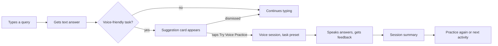

# Context: Smart Voice Suggestions (ChatGPT Voice Activation for Bharat Learners)

> Single source of truth for building the MVP. Consolidates everything in
> [problemStatement.txt](problemStatement.txt), which in turn consolidates three source documents:
>
> | Tag | Source | Contents |
> |---|---|---|
> | **M1** | `Milestone 1.pdf` — "India is Primed for Voice" (3 slides) | Market analysis, ChatGPT voice UX audit + competitor lessons, why the outcome matters + metric tree |
> | **M2** | `Milestone 2.pdf` — "Picking the segment to win in India" (3 slides) | Segmentation + sizing, survey validation, problem framing canvas |
> | **PRD** | PRD: Smart Voice Suggestions (11 pages, Nov 7, 2026, author: Anuj Gupta) | Buildable, testable product spec |
>
> Flow of reasoning: **M1** (why voice, why India) → **M2** (which segment, is the problem real) → **PRD** (what to build and how to prove it).
>
> The tech stack and implementation approach are **not decided yet**. They will come in a separate prompt. This file is about the product only and does not assume a stack.

---

## 1. Problem statement (TL;DR)

Bharat Learners are students aged 18–24 in Tier-2/3 Indian cities who mostly use regional languages. About **7M** of them use ChatGPT weekly. Most **know** ChatGPT Voice exists (~80%) and **have tried it** (~85%), but only **~19–20% use it often**.

Demand and awareness are not what holds them back. **Nothing in their study flow tells them *when* voice beats typing**, so they fall back on typing (~70% "prefer typing"). The voice entry point is small and gives no reason to use it, and users have doubts about accents and privacy. ChatGPT fails to turn the voice habit these users already have (WhatsApp voice notes, YouTube voice search) into a study habit.

**Solution: Smart Voice Suggestions.** It detects voice-friendly learning tasks (mock interviews, spoken English practice, viva/oral revision, pronunciation) and offers a **one-tap, task-preset voice session in context**, shown **below the normal text answer**.

**Goal:** grow **Weekly Active Voice Learners (WAVL)** and **D7 voice retention** without hurting text-chat quality.

> **Core insight:** Voice has a retention/activation problem, not an awareness problem.
> "Demand exists. Activation is broken." · "Availability ≠ habit adoption."

---

## 2. Market context (M1: "India is Primed for Voice")

### 2.1 Market opportunity
**Mobile-first**
- 500M+ smartphone users; fastest growing market
- Mobile is the primary internet device for the majority
- Small screens make typing friction-heavy
- Voice reduces interaction friction by 60%+

**Multilingual reality**
- 22 official languages, hundreds of dialects
- Regional-language typing is 3× slower than English
- Keyboard layouts are complex for non-Latin scripts
- Users are 2× more likely to speak than type in regional languages

### 2.2 Existing voice behaviour in India
| Product | Behaviour | Proof point |
|---|---|---|
| WhatsApp | Voice notes are mainstream communication | 100M+ voice messages daily |
| YouTube | Voice search helps discovery | 30% of searches are voice-based in India |
| Google Assistant | Utility tasks are normalized | Weather, alarms, directions, reminders |
| Alexa | Conversational interactions are trusted | Smart home adoption growing 40% YoY |

**Is India ready for voice? Yes.** It is a strong voice market. Users already use voice for communication, search and utility tasks. The opportunity for ChatGPT is to reduce friction through better **discoverability**, **trust**, and **support for Indian-language use cases**.

### 2.3 Why voice adoption is low on ChatGPT (UX audit)
| Gap | Description |
|---|---|
| Discoverability | Voice isn't strongly surfaced |
| No contextual nudges | Missing "Try voice" prompts |
| Trust & uncertainty | Recording concerns, accent and language doubts |
| Weak onboarding | No clear value explanation |

Visual evidence: in the ChatGPT mobile input bar, the mic icon is small and sits among the other icons (+, Search, Reason, voice-mode button). It is "easy to miss", so ChatGPT's voice entry is visually subtle.

### 2.4 What competitors do better
| Product | UX pattern | PM lesson |
|---|---|---|
| WhatsApp | One-tap voice note | Ultra-low friction |
| Google Assistant | Voice-first default | Discoverability |
| YouTube | Prominent voice search icon | Contextual utility |
| Alexa | Conversational feedback | Trust + clarity |

Competitors make voice visible, simple and trustworthy. ChatGPT treats it as optional.

**Key product insights:** Demand exists, activation is broken · No compelling "why voice?" trigger · Availability ≠ habit adoption.

### 2.5 Why the outcome matters
- **Engagement:** more voice usage → higher session frequency and time-on-app
- **Retention:** voice-first users show stronger habit formation and lower churn
- **Differentiation:** voice becomes a competitive moat in India's mobile-first market

> "Voice is not a feature — it's a market entry strategy for India."

### 2.6 Metric tree (M1)
```
Increase ChatGPT Voice Usage (North Star goal)
= Active Users  ×  Voice Adoption Rate  ×  Voice Usage Frequency

Active Users (people who can potentially use voice)
  = New Users (first-time) + Returning Users (previously active)
      New Users       = New Installs (India) + Install-to-Signup Rate
      Returning Users = Reactivated Users + Existing Active Users

Voice Adoption Rate (% of active users who try voice)
  = Discovery (reach) × Activation (success)
      Discovery  → Voice Icon Visibility (% users exposed)
      Activation → First Voice Completion (completion rate)

Voice Usage Frequency (how often adopters use voice)
  = Sessions/User (voice sessions per active user) × Queries/Session
      Sessions/User   → Days Active (voice days per user) × Sessions per Active Day
      Queries/Session → Queries per Session × Multi-turn Depth (follow-up rate)

North Star Metric (M1): Weekly Active Voice Users (India)
  (The PRD narrows this to Weekly Active Voice Learners, WAVL.)
```

---

## 3. Segment choice and validation (M2)

### 3.1 Candidate segments
(Lens framework from M1: WHO → HOW → WHY → WHAT → ENGAGED)

| ID | Segment | Who | Note | Why not first (PRD) |
|---|---|---|---|---|
| **S1** | **Bharat Learners (CHOSEN)** | 18–24, Tier-2/3, regional-language first | Largest cohort; speak faster than they type | **Chosen:** largest group, and they speak faster than they type |
| S2 | Urban Professionals | Metros, English-fluent, premium devices | Already activated; voice = convenience | Already active; voice is only a convenience |
| S3 | Gig & SMB Operators | Shop owners, freelancers, delivery agents | Hands busy; voice for replies and listings | Main tasks aren't learning; later phase |
| S4 | First-Timers | Just installed, low feature awareness | Onboarding moment; high leverage | Hard to tell apart from S1 at the start |
| S5 | Power Users | Daily multi-modal use, Plus subscribers | Already use voice; low incremental impact | Little extra to gain |

### 3.2 Why S1 wins
**Impact = Size × Difficulty × Probability**
- **Size: HIGH.** 690M smartphones; Bharat is the next 100M users.
- **Difficulty: MEDIUM.** Voice removes typing friction, but accent, trust and privacy gaps remain.
- **Probability: HIGH.** 30% of Google searches in India are already by voice.

> "Voice behaviour exists. ChatGPT activation is broken."

### 3.3 Sizing (top-down)
| Stage | Users | Conversion |
|---|---|---|
| India smartphone users | 690M | — |
| Learners 18–24, Tier-2/3 | ~110M | ~16% of above |
| Vernacular / regional-language first | ~22M | 20% of above |
| Use ChatGPT weekly | **~7M** (PRD chart: 6.6M) | ~30% of above |

- **~7M weekly active Bharat Learners** are the starting segment.
- **~22M vernacular-first learners** are the room to grow once voice becomes a habit.
- The voice habit already exists: YouTube voice search is widely used by Indian learners.

### 3.4 Survey and interviews
**Hypothesis:** Bharat Learners under-use ChatGPT voice because of **weak discoverability**, **low trust in accent/privacy**, and **missing "why voice" triggers**, not lack of demand.

**Activation cliff**
| Stage | M2 (n=20) | PRD (n=21) |
|---|---|---|
| Aware of voice mode | 80% (16/20, Q5) | 81% |
| Tried at least once | 85% (17/20, Q6) | 86% |
| Use voice often | 20% (4/20, Q6 "frequently") | 19% |

Note: more people reported trying voice than being aware of it. That is how the survey answers came out.

**Why they avoid voice: top blockers (multi-select)**
| Blocker | M2 (n=20) | PRD (n=21) |
|---|---|---|
| Prefer typing | 14 (70%) | 15 (71%) |
| Awkward speaking aloud | 5 (25%) | 6 (29%) |
| Voice feels slow | 4 (20%) | 4 (19%) |
| Did not know | 3 (15%) | — (not in PRD chart) |
| Privacy concerns | 3 (15%) | 3 (14%) |
| Accent not understood | 2 (10%) | 2 (10%) |

**Where voice would win: use cases (multi-select, n=20)**
| Use case | Count |
|---|---|
| Hands-free | 13 (65%) |
| Mock interviews | 11 (55%) |
| English practice | 11 (55%) |
| Quick doubts | 8 (40%) |
| Regional queries | 2 (10%) |

**What we heard (verbatim, Q11)**
- **Discoverability:** "The voice feature is not very inviting — I only tried it when I had to test usability." — R13
- **Awkwardness:** "Not getting personal space — voice usage feels uncomfortable." — R7
- **Friction:** "Couldn't find the setting to change voice speed and accent." — R16

**Interpretation (PRD):** preferring to type is a **habit problem**. A well-timed prompt can address it, and **no speech-model change is needed**. Accent and privacy are real concerns but affect fewer people.

**Research method:** an online survey plus short interviews with ChatGPT-using students aged 18–24 from Tier-2/3 cities. This was early validation, not a statistically significant study. The A/B test is how it gets confirmed.

**Verdict:** demand confirmed; activation broken.

### 3.5 Problem framing canvas
| Question | Answer |
|---|---|
| What is the true problem? | Bharat Learners know ChatGPT voice exists but don't use it for study tasks. Nothing in context makes voice feel like the right tool for the moment. |
| Who faces it? | Bharat Learners (18–24, Tier-2/3, regional-language first) who actively use ChatGPT but default to typing despite knowing about voice. |
| How do we know it's real? | Survey: 80% aware, 85% tried, only 4/20 use voice often; 70% prefer typing; R13 quote. |
| Value for customers | Faster, hands-free study help in their own language; less friction to learn, practise English and solve doubts without typing. |
| Value for business | Activates the next 100M Bharat users; voice becomes a defensible India moat against Gemini's voice-first lead. |
| Why now? | Users already use voice elsewhere (YouTube, WhatsApp), but ChatGPT isn't turning that habit into study behaviour. The window to build a voice habit before competitors lock it in is narrowing. |

---

## 4. Product spec (PRD)

### 4.1 Overview
| Field | Detail |
|---|---|
| Product | ChatGPT mobile app (**Android first**, then iOS), India |
| Feature | Smart Voice Suggestions: in-chat, context-aware prompts to switch to Voice Mode |
| Target segment | Bharat Learners: 18–24, Tier-2/3 cities, mostly regional languages (~7M WAU) |
| Stage | Discovery done. MVP ready to build and A/B test. |
| Stakeholders | Product, Design, Applied ML (intent detection), Voice platform, Data science, Trust & Safety, Localization, India growth marketing |
| Prototype | ask-listen-speak.lovable.app |

### 4.2 Why now (PRD)
India has ~690M smartphone users. Typing in regional scripts is ~3× slower than in English. Voice is already mainstream: WhatsApp carries 100M+ voice notes a day, and ~30% of searches in India are by voice. WhatsApp, YouTube and Google Assistant all put voice **one tap away**. In ChatGPT the voice button is small and nothing explains why to use it. If ChatGPT doesn't build this habit now, **Gemini**, which already leads with voice, may build it first.

### 4.3 Hypothesis (PRD)
Bharat Learners under-use ChatGPT Voice for three reasons:
1. there is **no prompt in context**,
2. they are **unsure how it handles accents and privacy**, and
3. there is **no clear reason to choose voice over typing**.

Lack of demand is not the reason. **If we offer voice at the right moment in a learning task, more learners will start a voice session and come back to it.**

### 4.4 Goals
1. **User goal:** learners can tell when voice is the better tool for a study task, and can start it in **one tap without losing context**.
2. **Business goal:** grow WAVL and improve retention in the Bharat Learner segment, so voice becomes something competitors can't easily copy in India.
3. **Learning goal:** test the hypothesis that weak prompting, not weak demand, keeps voice usage low.

Main goal: **turn one-time voice trials into a weekly study habit.**

### 4.5 Non-goals (out of scope)
- Improving speech or accent recognition
- New voice personalities or voices
- Translation features
- Changing the voice model, its pricing or paywall rules
- Other segments (urban professionals, gig workers, power users) and non-learning use cases

### 4.6 Success metrics
Targets are hypotheses, to be adjusted after measuring baselines in a **2-week pre-period**. Targets are over **8 weeks vs control**.

| Metric | Type | Definition | Target |
|---|---|---|---|
| **Weekly Active Voice Learners (WAVL)** | **North Star** | Bharat Learners with ≥1 voice session of **≥30s on a learning task** in the week | **+25% relative** |
| Voice start rate | Activation | Voice sessions started ÷ suggestions shown | **≥15%** |
| Voice sessions per user per week | Engagement | Voice sessions ÷ weekly active voice users in segment | **+20% relative** |
| D7 voice retention | Retention | Share of first-time voice users who start another voice session 1–7 days later | **+5 pp** |
| D30 retention | Retention | App-level D30 retention for the segment | No drop; aim +2 pp |
| Opt-out rate | Guardrail | Users who turn suggestions off ÷ users shown one | **≤5%** |
| Text-chat satisfaction | Guardrail | Thumbs-down rate on responses that show a suggestion | No significant rise |

### 4.7 Persona
**Rahul Kumar, 20.** An engineering student in a Tier-2 city. He uses ChatGPT for assignments, interview prep and English practice, and sends WhatsApp voice notes and searches YouTube by voice every day. **On ChatGPT he still types, because he can't tell when voice would help more.**

### 4.8 Jobs to be done
- When I'm **preparing for a placement interview**, I want to practise answering out loud, so I sound confident on the day.
- When I'm **improving my spoken English**, I want a patient partner who corrects me, so I can practise without feeling embarrassed.
- When I'm **revising for a viva or exam**, I want to explain a concept and get questions back, so I find my gaps quickly.

**Current journey:** study task → open ChatGPT → type query → read answer → type follow-up → keep typing. *Voice never comes up at any step.*

### 4.9 Options considered (RICE)
| Option | Description | Reach | Impact | Confidence | Effort | Priority |
|---|---|---|---|---|---|---|
| **A. Smart Voice Suggestions** | Offer Voice Mode during tasks such as interview prep, spoken English practice and viva prep | High | High | High | Low | **Highest: build now** |
| B. Voice Preview Mode | A 30-second guided voice demo before a full session | Medium | Medium | Medium | Low | Medium: v2 candidate, can sit on top of A |
| C. Voice Learning Challenges | Structured 7-day voice challenges for speaking, interviews and concepts | Medium | Medium | Medium | High | Low: revisit once a habit loop is proven |

**Why A:** it targets the main research finding head-on: users don't know **when** to use voice. It meets them inside the typed chat they already use, reuses the existing Voice Mode, scores highest on RICE for the lowest effort, and gives a clean exposure event for A/B testing.

### 4.10 How it works
1. **Detect:** a lightweight classifier tags the typed query as voice-friendly. Intent classes: **mock interview**, **speaking practice / spoken English**, **viva or oral revision**, **pronunciation**.
2. **Suggest:** under ChatGPT's normal text answer, a card appears:
   > **Practice with Voice**: speak your answers out loud and get instant feedback on your confidence and accuracy.
   > **[Try Voice Practice]**

   The text answer **always comes first and is never blocked**.
3. **Start in context:** one tap opens Voice Mode **already set for the task** (e.g. *Interview Practice* opens with its first question), so the user doesn't repeat themselves.
4. **Close the loop:** when the session ends, a summary shows **duration**, **questions practised** and **progress toward a streak goal**, offers **[Practice Again]** / **[Back to Chat]**, and suggests a **next voice activity**.

### 4.11 User flow
"One tap turns a typed study task into a voice session"



Voice is **offered, never forced**. If the user dismisses the card or the task isn't voice-friendly, they keep typing as they do today.

### 4.12 Functional requirements
The MVP covers **every P0**. P1 items ship in the same release if capacity allows, or in the next one.

| ID | Requirement | Priority | Acceptance criteria |
|---|---|---|---|
| FR-1 | Detect voice-friendly learning intent in typed queries (mock interview, spoken English, viva/oral revision, pronunciation) | **P0** | Precision **≥85%** on a labelled set of **≥1,000** Indian learner queries (**English and Hinglish**). Text replies get no slower in any way users notice. |
| FR-2 | Show a Smart Voice Suggestion card below the text answer | **P0** | Task-specific title, one line on why voice helps, and a **Try Voice Practice** button. Text answer always renders first. |
| FR-3 | Open Voice Mode with the task already set | **P0** | One tap opens a session labelled with the task (e.g. "Interview Practice"). The **assistant speaks first** with a relevant prompt. **Chat context carries over.** |
| FR-4 | Let users dismiss and turn off suggestions | **P0** | Every card has a dismiss (×) and a **"Don't suggest voice"** option. Turning it off works at once and **can be reversed in Settings**. |
| FR-5 | Limit how often suggestions appear | **P0** | At most **1 per conversation** and **3 per user per week**. After **3 dismissals in a row**, suggestions **pause for 14 days**. |
| FR-6 | Reassure users on privacy before the first session | **P0** | On **first use**, a short line covers how voice data is handled, with a **link to the policy**. Existing policy only; no new data collection. |
| FR-7 | Handle a denied mic permission smoothly | **P0** | If the mic is blocked, explain why it's needed, offer a **link to settings**, and **return to text with no dead end**. |
| FR-8 | Show a session summary screen | P1 | Duration, number of questions practised, **one improvement tip**, streak progress; **Practice Again** and **Back to Chat**. |
| FR-9 | Suggest a next voice activity | P1 | The summary suggests one related activity (e.g. "Practise HR questions next"). |
| FR-10 | Easy-to-find speed and accent controls | P1 | Speed and accent controls reachable in **one tap** from the active voice session screen (addresses R16's quote). |
| FR-11 | Localized suggestion copy | P1 | Card copy in **English and Hindi** first, then the **top 3 regional languages** by segment usage. |

### 4.13 Non-functional requirements
- **Performance and reliability:** intent detection adds **no wait** to text replies. Voice sessions start in **<2s on a mid-range Android phone over 4G**. If the classifier or voice service fails, **the card is hidden and text chat carries on**.
- **Privacy and accessibility:** no new audio or transcript storage beyond the current Voice Mode policy. Follows **India's DPDP Act** rules on notice and consent. The card works with **TalkBack and VoiceOver** and meets **WCAG AA**.
- **Control:** a **server-side kill switch** can turn off suggestions by **region, language or cohort** without an app release.

### 4.14 Edge cases
| Scenario | Expected behaviour |
|---|---|
| Ambiguous query (e.g. "explain interview questions for testers") | Show the card only above the **confidence threshold**; otherwise show nothing. |
| Noisy or shared space | Card subtext suggests **headphones**. The voice session shows a **"noisy room" hint** if input quality drops. |
| User switches to Hindi or Hinglish mid-session | Session continues in the **detected language**. The summary is written in the language the user **spoke most**. |
| Network drops during a voice session | **Save the transcript so far** and offer to **continue in text without losing context**. |

### 4.15 Experiment plan
Randomized **A/B test for 4 weeks**. Ship only if **voice start rate AND D7 voice retention both improve** and **no guardrail is breached**.
- **Population:** India users aged 18–24 in Tier-2/3 regions who send ≥1 eligible learning query; **50/50 split at user level**, Control (no card) vs Treatment.
- **Primary metric:** voice start rate among **eligible** users in both arms (so control isn't undercounted). **Secondary:** sessions per user, D7 voice retention, WAVL.
- **Length and size:** 4 weeks, so D7 has time to mature and exam weeks and weekends even out. Sized to detect a **2 pp lift at 95% confidence and 80% power**.
- **Instrumentation events:** `suggestion_eligible`, `suggestion_shown`, `suggestion_tapped`, `suggestion_dismissed`, `voice_session_started`, `voice_session_completed`. Each is tagged with **intent type, language, arm**. (The PRD lists these events in prose; the snake_case names are a naming convenience.)
- **Decision rules:**
  - **Ship** if primary metrics improve and guardrails hold.
  - **Iterate** if taps rise but D7 stays flat (fix the in-session experience).
  - **Kill** if opt-outs exceed 5% or text satisfaction drops.

### 4.16 Launch plan
Each phase needs the previous phase's gate to pass.

| # | Phase | Gate |
|---|---|---|
| 1 | Internal dogfood (2 weeks): India staff and a student beta panel | Classifier precision ≥85%, no P0 bugs, privacy copy approved by Legal and Trust & Safety |
| 2 | A/B test at 10% of eligible users (4 weeks) | Primary metrics clear the targets; guardrails hold |
| 3 | Ramp to 50%, then 100% in India; add Hindi, then regional-language card copy | Results hold at scale; voice infrastructure cost per WAVL within budget |
| 4 | v2 bets: Voice Preview Mode on top, then Voice Learning Challenges for users who have built a habit | — |

### 4.17 Risks and mitigations
| Risk | Likelihood | Mitigation |
|---|---|---|
| Suggestions feel pushy to the 71% who prefer typing | **High** | Frequency limits, easy dismiss and opt-out, opt-out guardrail, contextual triggers only |
| Speaking aloud feels awkward in hostels and libraries | Medium | Copy that suggests headphones; whisper/low-volume mode as a v2 candidate |
| Accent or Hinglish recognition fails and trust drops after the first try | Medium | Start with tasks where recognition already performs well; flag poor sessions; share data with the speech team |
| More voice use raises infrastructure cost | Medium | Track cost per WAVL, cap session length in the MVP, use the kill switch |

### 4.18 Decisions taken
- **Prompt before model:** v1 changes **when** voice is offered, not how speech recognition works. Accent and recognition work stays with the speech team.
- **Suggestions, not a default switch:** text stays the default and voice is always opt-in, so we don't push away the 71% who prefer typing.
- **English and Hinglish first:** regional-language card copy follows in the ramp phase, once the classifier proves reliable.

---

## 5. Traceability: research → features

### 5.1 M1 UX gaps → PRD features
| M1 gap | Addressed by |
|---|---|
| Discoverability | FR-1 intent detection + FR-2 in-chat card |
| No contextual nudges | FR-1/FR-2 (card only on voice-friendly tasks); FR-5 frequency limits |
| Trust & uncertainty | FR-6 privacy line, FR-7 mic handling, FR-10 speed/accent controls, headphone/noisy-room edge cases |
| Weak onboarding / no "why voice" | FR-2 card copy, FR-3 task preset, FR-8/FR-9 summary + next activity (closes the habit loop) |

### 5.2 Competitor lessons → design choices
| Lesson | Applied as |
|---|---|
| WhatsApp: one-tap, ultra-low friction | One tap from card to a preset voice session |
| YouTube: contextual utility | Suggestion appears only in relevant study contexts |
| Alexa: conversational feedback, trust | Assistant speaks first; summary with feedback |
| Google Assistant: voice-first default | **Deliberately not copied.** Text stays default; voice is opt-in |

### 5.3 Survey findings → PRD response
| Finding | Response |
|---|---|
| Prefer typing (70–71%) | Habit problem → well-timed contextual prompt, not a model change; anti-pushiness guardrails |
| Awkward aloud (25–29%) | Headphone copy; whisper mode as a v2 candidate |
| Privacy (14–15%) | FR-6 using existing policy; DPDP compliance |
| Accent (10%) | Out of scope for v1 (speech team); FR-10 controls; start with tasks where recognition already works well |
| Mock interviews / English practice (55% each) | Become classifier intent classes and task presets |
| Hands-free (65%) | Overall value proposition |

---

## 6. MVP build reference (stack-agnostic)

This section restates the PRD as buildable rules. The stack, libraries and AI/voice providers are **TBD** and will come in a later prompt.

### 6.1 MVP scope
- **Must (P0):** FR-1 → FR-7, plus the non-functional rules (text never blocked, card hidden on failure, kill switch, accessibility).
- **Should (P1):** FR-8 → FR-11.
- **Won't (non-goals / v2):** speech-model or accent improvements, new voices, translation, pricing or paywall changes, other segments, Voice Preview Mode, Voice Learning Challenges, whisper mode.

### 6.2 Core screens and components
1. **Chat screen:** ChatGPT-style text chat (user query → text answer).
2. **Smart Voice Suggestion card:** rendered **below** the text answer. Task-specific title, one-line "why voice" copy, **Try Voice Practice** button, dismiss (×), "Don't suggest voice" option. Optional headphone hint in subtext.
3. **First-use privacy notice:** a short line plus a policy link before the first voice session.
4. **Mic-permission-denied state:** explains why, links to settings, returns to text.
5. **Voice session screen:** labelled with the task (e.g. "Interview Practice"); the assistant speaks first; carries chat context; speed and accent controls one tap away; "noisy room" hint.
6. **Session summary screen:** duration, questions practised, one improvement tip, streak progress, Practice Again / Back to Chat, a suggested next activity.
7. **Settings:** toggle to re-enable or disable voice suggestions.

### 6.3 Intent classes and task presets
| Intent class | Example task preset | Assistant opens with |
|---|---|---|
| `mock_interview` | Interview Practice | First interview question |
| `spoken_english` | Spoken English Practice | A conversation prompt with gentle correction |
| `viva_revision` | Viva / Oral Revision | Asks the learner to explain a concept, then asks questions back |
| `pronunciation` | Pronunciation Practice | A word or phrase to say aloud |
| `none` | — (no card) | — |

Only show the card when the classifier is **above the confidence threshold**. Ambiguous queries get no card. Classifier languages for v1: **English + Hinglish**.

### 6.4 Business rules and constants
| Rule | Value |
|---|---|
| Max suggestions per conversation | 1 |
| Max suggestions per user per week | 3 |
| Consecutive dismissals before pause | 3 |
| Pause duration after that | 14 days |
| Classifier precision target | ≥85% on ≥1,000 labelled queries |
| Voice session start latency | <2s (mid-range Android, 4G) |
| WAVL qualifying session | ≥30s on a learning task |
| Opt-out guardrail | ≤5% |
| Voice start rate target | ≥15% |
| Text answer order | Always before the card; never blocked |
| On classifier/voice failure | Hide the card; text chat continues |
| Card copy languages | English + Hindi first → top 3 regional languages |

### 6.5 Suggestion eligibility logic
```
on text answer rendered:
  if suggestions disabled by user            -> no card
  if kill switch on (region/language/cohort) -> no card
  if paused (3 dismissals in a row, <14 days) -> no card
  if already shown in this conversation      -> no card
  if shown >= 3 times this week              -> no card
  intent, confidence = classify(query)       # must not delay text answer
  if classifier error or intent == none
     or confidence < threshold               -> no card
  log suggestion_eligible
  render card below answer; log suggestion_shown
```

### 6.6 Analytics events
`suggestion_eligible`, `suggestion_shown`, `suggestion_tapped`, `suggestion_dismissed`, `voice_session_started`, `voice_session_completed`. Each is tagged with `intent_type`, `language`, `arm` (control/treatment).
Derived metrics: voice start rate, sessions per user per week, D7 voice retention, WAVL, opt-out rate, thumbs-down rate on responses with a card.

---

## 7. Numbers that differ between documents
| Item | M1 | M2 | PRD |
|---|---|---|---|
| India smartphone users | 500M+ | 690M | ~690M |
| Survey sample | — | n=20 | n=21 |
| Aware / tried / frequent | — | 80% / 85% / 20% (4/20) | 81% / 86% / 19% |
| Prefer typing | — | 14 (70%) | 15 (71%) |
| Awkward aloud | — | 5 (25%) | 6 (29%) |
| "Did not know" blocker | — | 3 (15%) | not shown |
| Weekly active S1 | — | ~7M | 6.6M chart / ~7M text |
| 30% voice-search stat | "of searches" (YouTube card) | "of Google searches" | "of searches in India" / "of Google searches" |
| North Star | Weekly Active Voice Users (India) | — | Weekly Active Voice Learners (WAVL) |
| Survey label | — | Shown in M2 deck | Called "Milestone 1 user survey" |

---

## 8. Key takeaways
1. India is voice-ready (WhatsApp, YouTube, Assistant habits). ChatGPT's voice is under-surfaced and lacks a "why voice" trigger.
2. Target: **Bharat Learners** (18–24, Tier-2/3, vernacular-first): ~7M weekly ChatGPT users today, ~22M headroom.
3. The bottleneck is **between trial and habit** (an activation/retention cliff), not awareness or demand.
4. The fix is **behavioural/UX** (when to offer voice), not model-level (how speech is recognised).
5. **Smart Voice Suggestions** = detect voice-friendly study intent → suggest below the text answer → one-tap task-preset voice session → summary + streak + next activity.
6. Success = **WAVL +25%**, **voice start rate ≥15%**, **D7 voice retention +5 pp**. Guardrails: **opt-out ≤5%**, no rise in text thumbs-down.
7. Safeguards against being pushy: 1 per conversation, 3 per week, 14-day pause after 3 dismissals in a row, easy opt-out, kill switch, text always first.
