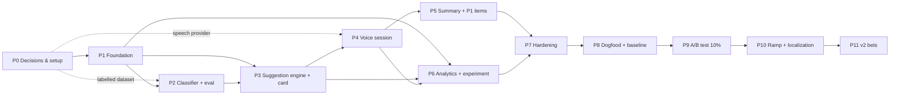

# Implementation Plan: Smart Voice Suggestions MVP

> Built from [architecture.md](architecture.md) (components C1–C8 and S1–S13, flows, config, Groq integration) and [context.md](context.md) (PRD requirements, metrics, launch plan).
>
> **Fixed:** Groq is the only LLM provider (architecture §6.7).
> **Phase 0 decided the rest** ([decisions.md](decisions.md), status in [phase0/README.md](phase0/README.md)):
> - responsive React + Vite + TS website
> - Node.js + TS (Fastify)
> - PostgreSQL
> - Groq Whisper STT + browser TTS
>
> **Still open:** hosting and authentication. Tasks below stay worded stack-agnostic; read them with these choices.
>
> **Estimates are proposed.** Durations assume a small team: 2 backend engineers, 1–2 client engineers, 1 ML engineer, part-time data analyst and designer, with Legal / T&S review on call. Adjust them once the stack and team are known.

---

## Contents
1. [Plan at a glance](#1-plan-at-a-glance)
2. [Phase dependency graph](#2-phase-dependency-graph)
3. [Timeline](#3-timeline)
4. [Phases](#4-phases)
   - [Phase 0: Decisions, setup and long-lead work](#phase-0-decisions-setup-and-long-lead-work)
   - [Phase 1: Foundation (chat, Groq gateway, data, config, events)](#phase-1-foundation-chat-groq-gateway-data-config-events)
   - [Phase 2: Intent classifier and eval harness](#phase-2-intent-classifier-and-eval-harness)
   - [Phase 3: Suggestion engine, card and user controls](#phase-3-suggestion-engine-card-and-user-controls)
   - [Phase 4: Voice session](#phase-4-voice-session)
   - [Phase 5: Summary, habit loop and remaining P1](#phase-5-summary-habit-loop-and-remaining-p1)
   - [Phase 6: Analytics, experiment and dashboards](#phase-6-analytics-experiment-and-dashboards)
   - [Phase 7: Hardening and launch readiness](#phase-7-hardening-and-launch-readiness)
   - [Phase 8: Internal dogfood and baseline pre-period](#phase-8-internal-dogfood-and-baseline-pre-period)
   - [Phase 9: A/B test at 10%](#phase-9-ab-test-at-10)
   - [Phase 10: Ramp and localization](#phase-10-ramp-and-localization)
   - [Phase 11: v2 bets (after the MVP)](#phase-11-v2-bets-after-the-mvp)
5. [Requirement coverage by phase](#5-requirement-coverage-by-phase)
6. [Decisions needed, and by when](#6-decisions-needed-and-by-when)
7. [Plan-level risks](#7-plan-level-risks)
8. [Definition of done](#8-definition-of-done)

---

## 1. Plan at a glance

| Phase | Name | Proposed weeks | Main outcome | PRD launch phase |
|---|---|---|---|---|
| 0 | Decisions, setup, long-lead work | W1 | Stack + speech decided; Groq keys; labelling and Legal review started; P0 designs | — |
| 1 | Foundation | W2–W3 | Streaming chat on Groq; LLM gateway; DB; config + kill switch; event pipeline | — |
| 2 | Intent classifier + eval | W3–W4 | Classifier at ≥85% precision on ≥1,000 queries, with an eval harness in CI | — |
| 3 | Suggestion engine + card | W4–W5 | Card appears below the answer, with caps, dismiss, opt-out, A/B arms | — |
| 4 | Voice session | W5–W7 | One-tap task-preset session, assistant speaks first, <2s start | — |
| 5 | Summary + remaining P1 | W8–W9 | Summary, streak, next activity, Hindi card copy | — |
| 6 | Analytics + experiment | W6–W9 (parallel) | Full event catalogue, metrics, dashboards, alerts, A/A check | — |
| 7 | Hardening | W9–W10 | Performance, accessibility, privacy, security, chaos, runbooks | — |
| 8 | Dogfood + baseline pre-period | W11–W12 | Dogfood gate passed; 2-week baselines measured | **1. Internal dogfood** |
| 9 | A/B test at 10% | W13–W16 (+W17 analysis) | Ship / Iterate / Kill decision | **2. A/B test** |
| 10 | Ramp + localization | W17+ | 50% → 100% India; Hindi → top 3 regional languages | **3. Ramp** |
| 11 | v2 bets | Later | Voice Preview Mode, then Voice Learning Challenges | **4. v2 bets** |

**MVP build (P0 + P1) ends at the close of Phase 7 (~10 weeks).** Phases 8–10 are the PRD rollout.

---

## 2. Phase dependency graph

**Critical path:** P0 → P1 → P3 → P4 → P5 → P7 → P8 → P9.
**Long-lead items that must start in Phase 0:**
- the labelled query dataset (gates Phase 2 and the dogfood gate)
- Legal / T&S review of the privacy copy and Groq's terms (gates dogfood)
- the speech-provider choice (gates Phase 4)

---

## 3. Timeline

| Phase | W1 | W2 | W3 | W4 | W5 | W6 | W7 | W8 | W9 | W10 | W11 | W12 | W13–16 | W17+ |
|---|---|---|---|---|---|---|---|---|---|---|---|---|---|---|
| 0 Decisions & setup | ■ | | | | | | | | | | | | | |
| 1 Foundation | | ■ | ■ | | | | | | | | | | | |
| 2 Classifier + eval | ░ | | ■ | ■ | | | | | | | | | | |
| 3 Suggestion engine + card | | | | ■ | ■ | | | | | | | | | |
| 4 Voice session | | | ░ | | ■ | ■ | ■ | | | | | | | |
| 5 Summary + P1 | | | | | | | | ■ | ■ | | | | | |
| 6 Analytics + experiment | | ░ | | | | ■ | ■ | ■ | ■ | | | | | |
| 7 Hardening | | | | | | | | | ■ | ■ | | | | |
| 8 Dogfood + baseline | | | | | | | | | | | ■ | ■ | | |
| 9 A/B test 10% | | | | | | | | | | | | | ■ | analysis |
| 10 Ramp | | | | | | | | | | | | | | ■ |

■ = main work. ░ = early or parallel work: dataset labelling in W1, a speech-provider spike in W3, the event-pipeline skeleton in W2.

**Schedule optimisation:** the PRD's 2-week **baseline pre-period** (instrumentation on, suggestions off) runs **at the same time as dogfood** (Phase 8). Dogfood uses only the staff/beta cohort, so the two don't interfere, and the A/B test starts 2 weeks earlier.

---

## 4. Phases

Each phase lists its goal, tasks (with the architecture components they touch), deliverables, exit criteria, and risks. Task IDs (e.g. `P3.4`) are for tracking.

---

### Phase 0: Decisions, setup and long-lead work
**Goal:** remove every blocker that would otherwise stall later phases.
**Weeks:** W1 · **Covers:** architecture §17 open decisions.

**Tasks**
- [ ] **P0.1** Decide the **tech stack** (client, backend, DB, analytics store) (§17 #1).
- [ ] **P0.2** Decide the **speech approach** (§17 #3): separate STT + TTS vs a realtime API. Candidates: Groq Whisper (`whisper-large-v3-turbo`) for STT, plus a TTS provider that supports **Hindi/Hinglish and English (Indian)**. Groq TTS is preview and English-only, so it isn't suitable on its own.
- [ ] **P0.3** Confirm the classifier approach (§17 #4). Recommended: **option B**, a rules prefilter + Groq `openai/gpt-oss-20b` with strict JSON schema.
- [ ] **P0.4** Confirm the proposed constants (§17 #5–#11):
  - grace window 500 ms
  - classifier timeout 1.5s (raised to 2s in Phase 2)
  - session cap 10 min
  - noisy-room N=2
  - reconnect 5s
  - streak goal 3 days
  - rolling 7-day weekly cap
  - what the "accent" control means
  - whether to append a recap on Back to Chat
  - which actions reset the dismissal counter
- [ ] **P0.5** **Groq setup:**
  - organisation account
  - separate projects and keys for dev, staging and prod
  - choose the rate-limit tier (§17 #14)
  - verify the model IDs in §6.7.1 against the current Groq models page
- [ ] **P0.6** **Legal / T&S kickoff** (long lead):
  - Groq data-processing and retention terms (§17 #13)
  - transcript-retention alignment with the Voice Mode policy (§17 #9)
  - first-use privacy line and mic explainer copy
  - DPDP notice and consent
- [ ] **P0.7** **Labelled dataset kickoff** (long lead):
  - labelling guidelines for the 5 classes (`mock_interview`, `spoken_english`, `viva_revision`, `pronunciation`, `none`)
  - target ≥1,000 Indian learner queries, English + Hinglish, with a separate **ambiguous set** (e.g. "explain interview questions for testers")
  - double-label a sample and measure agreement
- [ ] **P0.8** Repo, CI pipeline, environments (local / staging / prod), secret store (`GROQ_API_KEY`, speech keys), code owners.
- [ ] **P0.9** **Design** (P0 screens first):
  - suggestion card (with dismiss, opt-out and headphone hint)
  - first-use privacy notice
  - mic-denied state
  - voice session screen (states, end, speed/accent, noisy hint, reconnect)
  - summary screen
  - settings toggle

  Each comes with accessibility specs: reading order, labels, 48dp targets, contrast.

**Deliverables:** decision log (updates architecture §17), environments + keys, labelling guideline + first 200 labels, approved P0 designs, Legal review ticket.

**Exit criteria**
- Stack and speech provider decided and written into architecture.md.
- Groq keys work from staging; model IDs verified.
- Labelling running at a pace that reaches ≥1,000 labels by the end of W4.
- Legal / T&S review formally started, with a target date before W11.

**Risks:** the speech decision slips, which delays Phase 4. Mitigation: time-box it to W1 and run a 2-day spike on the top 2 options.

---

### Phase 1: Foundation (chat, Groq gateway, data, config, events)
**Goal:** a working streaming chat on Groq, with the platform pieces every later phase builds on.
**Weeks:** W2–W3 · **Components:** S1, S2, S7, S12, S13, C1, C7, C8, DB.

**Tasks**
- [ ] **P1.1 S13 LLM Gateway (Groq client)** (§6.7):
  - OpenAI-compatible Chat Completions calls
  - per-use-case model, timeout and concurrency from config
  - honour `retry-after` with jittered backoff; at most 1 retry within the time budget
  - fallback model per use case
  - strict `json_schema` support + server-side validation for `json_object` fallbacks
  - token-usage metering (use case, session, arm)
  - key never logged
- [ ] **P1.2** **Fake Groq server** for tests: can simulate 429 with `retry-after`, 5xx, timeouts, invalid JSON and slow first tokens.
- [ ] **P1.3 S2 Chat Service:** streaming answers with `openai/gpt-oss-120b` at low reasoning effort (fallback `openai/gpt-oss-20b`); reasoning text is never shown or stored; persist conversations and messages.
- [ ] **P1.4 S1 BFF:**
  - auth, per-user rate limiting
  - streaming protocol with events `answer.delta`, `answer.complete`, `suggestion` (reserved, unused yet), `stream.end` (§9.1)
  - `client_msg_id` idempotency
- [ ] **P1.5 DB schema + migrations** for all §8 entities: USER, CONVERSATION, MESSAGE, VOICE_PREFS, EXPERIMENT_ASSIGNMENT, SUGGESTION, VOICE_SESSION, VOICE_TURN, SESSION_SUMMARY. **No audio column.**
- [ ] **P1.6 S7 Config & Kill Switch:**
  - every `svs.*` key from §10 (including `svs.llm.*`)
  - hot reload (target ≤1 min)
  - audit log
  - kill-switch rules by region / language / cohort
  - evaluation order `enabled → kill_switch → rollout_percent`
- [ ] **P1.7 S12 Event Ingestion + C7 Event Logger:**
  - envelope from §12.1, with schema validation
  - batching and retry
  - enrichment with arm/cohort
  - write to the analytics store
  - reject events that contain free-text content fields
- [ ] **P1.8 C1 Chat UI:** streaming render, thumbs up/down (`answer_feedback` with `had_suggestion`), and an empty card slot below each answer.
- [ ] **P1.9 C8 Config Cache:** short-TTL client config (copy version, UI flags). Not authoritative for the kill switch.
- [ ] **P1.10** Measure **baseline text time-to-first-token (TTFT)** with SVS off. This is the reference for "text never slower".

**Deliverables:** streaming chat demo; gateway with tests; config admin path; events landing in the analytics store; TTFT baseline report.

**Exit criteria**
- Chat streams answers end-to-end in staging on Groq.
- Gateway tests pass against the fake server (429/5xx/timeout/invalid JSON → correct fallback or degrade).
- A config change takes effect within ≤1 min, and an audit entry is written.
- A test event reaches the analytics store with the full envelope.
- TTFT baseline recorded.

---

### Phase 2: Intent classifier and eval harness
**Goal:** FR-1, detecting voice-friendly learning intent at ≥85% precision without slowing text.
**Weeks:** W3–W4 (labelling since W1) · **Components:** S3, S13 · **FR:** FR-1.

**Tasks**
- [ ] **P2.1 Rules prefilter** (option B): keyword/pattern lists per intent in English + Hinglish (e.g. "interview", "viva", "pronounce", "spoken English", "bolna", "practice"). Tune for **high recall**; the LLM step handles precision.
- [ ] **P2.2 Classifier prompt v1:** system instructions + few-shot English/Hinglish examples. Groq `openai/gpt-oss-20b`, `temperature 0`, **strict `json_schema`** `{intent, confidence, language}` (request shape in §6.1). Non-streaming.
- [ ] **P2.3 Fallback path:** `openai/gpt-oss-120b` with the same strict `json_schema`, plus server-side validation. Invalid output = classifier error = no card.
- [ ] **P2.4 Classifier interface:**
  - `classify(query, recent_turns≤2, locale_hint?) → {intent, confidence, language, model_version, latency_ms}`
  - `model_version = <groq-model>@<prompt-version>`
  - hard timeout `svs.classifier.timeout_ms`
- [ ] **P2.5 Eval harness (CI):**
  - versioned dataset
  - per-intent precision and recall, confusion matrix
  - **threshold sweep** for the per-intent thresholds
  - ambiguous set must produce no card
  - runs on every prompt, model or threshold change
  - covers the primary **and** fallback models
- [ ] **P2.6** Write the tuned per-intent thresholds to config (`svs.classifier.threshold.{intent}`).
- [ ] **P2.7 Latency profile:** p50/p95 classifier latency vs typical answer duration, to confirm it fits inside `answer_complete + grace`.

**Deliverables:** classifier service, eval report v1, thresholds in config, CI eval job.

**Exit criteria**
- **Precision ≥85%** overall on ≥1,000 labelled queries (English + Hinglish), with per-intent precision reported.
- The ambiguous set produces no card at the chosen thresholds.
- p95 classifier latency within budget. On timeout it returns `none`, never an error into chat.
- The eval job blocks merges that drop precision below 85%.

**Risks:** Hinglish precision is low. Mitigation: add more Hinglish few-shot examples, raise the thresholds (trading recall for precision, as the PRD prefers), and widen the prefilter only if recall collapses.

---

### Phase 3: Suggestion engine, card and user controls
**Goal:** the right card, below the answer, for the right users, without ever slowing text, with full user control.
**Weeks:** W4–W5 · **Components:** S4, S5, S6, S11, S1, C2, C6 · **FR:** FR-2, FR-4, FR-5, NFR kill switch.

**Tasks**
- [ ] **P3.1 S5 Prefs & Counters:**
  - `suggestions_enabled`, `privacy_notice_seen_at`, `consecutive_dismissals`, `paused_until`
  - impressions (per conversation, rolling 7 days)
  - speed/accent, streak fields
  - **atomic** increments / compare-and-set so concurrent tabs can't exceed caps
- [ ] **P3.2 S6 Experiment Assignment:** deterministic hash of `(user_id, experiment_id)`, 50/50; persist to `EXPERIMENT_ASSIGNMENT`.
- [ ] **P3.3 S4 Decision Engine:** implement the §6.2 pipeline exactly, cheapest check first:
  - kill switch → opt-out → pause → conversation cap → weekly cap → arm → classify → threshold
  - log `suggestion_eligible` (both arms)
  - record impression (control = shadow)
  - control → no card
  - copy lookup → eligible

  Every "no" emits a reason code to metrics. Idempotent `suggestion_id = (conversation_id, message_id)`.
- [ ] **P3.4 BFF wiring:**
  - run the decision **in parallel** with the answer
  - send `suggestion` only after `answer.complete` and within `svs.suggestion.grace_ms` (500 ms)
  - late → drop, `reason=late`, impression not counted
  - any error → no card (fail closed)
- [ ] **P3.5 S11 Copy catalog:** English copy per intent:
  - task-specific title
  - why-line ("speak your answers out loud and get instant feedback on your confidence and accuracy")
  - CTA "Try Voice Practice"
  - dismiss and opt-out labels
  - headphone hint
- [ ] **P3.6 C2 Suggestion Card:**
  - renders only after the answer
  - title, why-line, CTA, dismiss (×), "Don't suggest voice", headphone hint
  - polite screen-reader announcement after the answer
  - reading order per §13.4
  - `suggestion_shown` fired when the card is actually visible
- [ ] **P3.7 Actions + APIs** (§9.2):
  - `dismiss` (increments the counter; 3 in a row → `paused_until = now + 14 days`, counter reset)
  - `tap` (resets the counter)
  - `PUT /me/voice-preferences` (opt-out, effective at once)
- [ ] **P3.8 C6 Settings:** a toggle to turn suggestions back on (and off). Fires `suggestions_opted_in` / `suggestions_opted_out`.
- [ ] **P3.9 Tests:**
  - unit tests for every decision branch, including rolling-window boundaries and idempotent retries
  - contract test: `answer.complete` always arrives before `suggestion`
  - chaos tests: classifier / prefs / config down → chat unaffected, no card
  - perf test: TTFT with SVS on = baseline (P1.10)

**Deliverables:** an end-to-end card in staging for treatment users; settings toggle; test suite.

**Exit criteria**
- FR-2, FR-4, FR-5 acceptance criteria pass (§4.12 of context.md).
- Kill switch by region / language / cohort hides cards within ≤1 min, with no release.
- TTFT unchanged versus baseline (no statistically significant difference).
- Control users never see a card but do generate `suggestion_eligible` events.

---

### Phase 4: Voice session
**Goal:** one tap → a task-preset voice session in which the assistant speaks first, the chat context carries over, and the first audio plays in <2s.
**Weeks:** W5–W7 (speech spike in W3) · **Components:** C3, C4, S8, S9, S13, S5 · **FR:** FR-3, FR-6, FR-7, FR-10 (controls), edge cases.

**Tasks**
- [ ] **P4.1 C3 Voice Onboarding:**
  - first-use privacy line + policy link (copy pending Legal approval)
  - `POST /me/privacy-notice-ack`
  - mic permission request **only after the tap**
  - denied/blocked state: explain why, "Open settings" deep link, "Back to text", event `mic_permission_denied`
- [ ] **P4.2 S9 Speech Gateway:** adapter for the chosen STT/TTS:
  - streaming STT with **language ID** and **confidence**
  - streaming TTS with **rate control**
  - locale hints `en-IN` / `hi-IN`
  - the vendor is hidden behind the adapter interface
- [ ] **P4.3 Presets as config** (`svs.presets`, §6.4): `interview_practice`, `spoken_english`, `viva_revision`, `pronunciation`. Each has a label, coach system prompt (prompt-versioned), opening behaviour, next-activity options and a static opening template.
- [ ] **P4.4 S8 session creation** (`POST /voice/sessions`):
  - load the preset + **last 6 chat turns** + user speed/accent
  - generate the **opening line** with Groq `openai/gpt-oss-20b` at low reasoning effort (600 ms budget → template fallback)
  - return `session_id`, stream URL + short-lived token, label, opening, settings, limits
- [ ] **P4.5 Pre-warm on card render:** resolve the preset and optionally pre-generate and pre-synthesize the opening line, to protect the <2s budget (§5.2).
- [ ] **P4.6 Turn loop** (§5.3):
  - STT final → coach prompt to Groq `openai/gpt-oss-120b` at low reasoning effort, **streaming** (fallback `openai/gpt-oss-20b`)
  - send the stream to TTS **sentence by sentence** so audio starts early
  - reply in the latest user turn's language
  - if both models fail: "Sorry, can you say that again?"
- [ ] **P4.7 In-session signals:**
  - per-language turn tally (dominant language)
  - question counter
  - **quality monitor**: low STT confidence for N=2 turns → `hint.noisy_room`
  - **length cap**: warning 1 minute before 10 min, then end → summary
- [ ] **P4.8 Transcript persistence** of finalized turns, **only as the Voice Mode policy allows**. Never store audio.
- [ ] **P4.9 Resilience** (§5.6):
  - WS reconnect up to 5s → `resume(last_turn_id)`
  - otherwise keep the local transcript and offer "Continue in text?"
  - `continue-in-text` appends a recap to the conversation
- [ ] **P4.10 C4 Voice Session UI:**
  - task label
  - assistant-first playback
  - listening/thinking/speaking states as text + live regions
  - end button
  - **speed and accent controls one tap away** (`PATCH /settings`, persisted to S5)
  - noisy-room hint, reconnect UX
- [ ] **P4.11 Entry points:** `entry_point` recorded (`suggestion_card | mic_button | practice_again | next_activity`). Events `voice_session_started` (with `start_latency_ms`), `voice_setting_changed`, `noisy_room_hint_shown`, `voice_session_network_drop`.
- [ ] **P4.12 Tests:**
  - E2E: the assistant speaks first and references the chat topic
  - mic denied → back to text
  - language switch mid-session
  - network throttling → continue in text
  - length cap
  - start latency on a **mid-range Android device over a 4G profile**

**Deliverables:** a working voice session from the card in staging; device latency report.

**Exit criteria**
- FR-3, FR-6, FR-7 acceptance criteria pass; FR-10 controls work.
- **Voice start <2s p90** (from session request to first assistant audio) on a mid-range Android phone over 4G.
- Turn latency close to the proposed p50 ≤1.5s / p90 ≤2.5s (record the actual numbers).
- All 4 edge cases from the PRD behave as specified.

**Risks:**
- TTS latency or quality for Hinglish. Mitigation: the Phase-0 spike, sentence-level streaming, a short opening line.
- Groq rate limits during voice bursts. Mitigation: separate concurrency budgets; coach calls get priority over classifier calls.

---

### Phase 5: Summary, habit loop and remaining P1
**Goal:** close the habit loop (FR-8, FR-9) and finish the P1 items (FR-10 polish, FR-11 Hindi copy).
**Weeks:** W8–W9 · **Components:** S10, C5, S5, S11 · **FR:** FR-8, FR-9, FR-10, FR-11.

> The PRD lets P1 items slip to the next release if capacity is short. If the schedule is at risk, ship Phase 8 dogfood with P0 only and add Phase 5 before the A/B test. The summary should still land **before the A/B test**, because D7 retention is a primary metric and the summary is the habit-loop driver.

**Tasks**
- [ ] **P5.1 S10 summary build** (`POST /voice/sessions/{id}/end`):
  - duration (excluding reconnect gaps)
  - questions practised (assistant question → user answer pairs)
  - dominant language
  - `qualifies_for_wavl` (≥30s on a learning intent)
- [ ] **P5.2 Tip + next activity** via Groq `openai/gpt-oss-120b`, **strict `json_schema`**, non-streaming, 8s timeout:
  - exactly one actionable tip in the dominant language
  - a next activity chosen from the preset's list
  - fallback `openai/gpt-oss-20b`; if both fail, show the summary without a tip
- [ ] **P5.3 Streak:** consecutive local days with ≥1 qualifying session against the goal (default 3). Handle time zones and day boundaries.
- [ ] **P5.4 C5 Summary UI:**
  - duration, questions, tip, streak progress
  - **Practice Again** (same preset)
  - **Next activity** (FR-9)
  - **Back to Chat**, with the recap per decision §17 #10
  - event `summary_action`, plus `voice_session_completed`
- [ ] **P5.5 FR-11:** Hindi card copy in S11 (translated, reviewed by a native speaker, Legal-approved where needed). The top-3 regional languages are deferred to Phase 10.
- [ ] **P5.6 Tests:**
  - E2E for all three summary actions
  - streak across midnight and time zones
  - summary language after a mid-session language switch
  - Hindi copy QA on device (truncation, fonts)

**Exit criteria:** FR-8, FR-9, FR-10, FR-11 (English + Hindi) acceptance criteria pass; `qualifies_for_wavl` is set correctly in all tests.

---

### Phase 6: Analytics, experiment and dashboards
**Goal:** everything needed to measure the PRD metrics and run the A/B test credibly.
**Weeks:** W6–W9, in parallel (events are added inside each feature phase; this phase completes and validates them) · **Components:** S12, S6, analytics store.

**Tasks**
- [ ] **P6.1** Complete the **event catalogue** (§12.2), with schema tests: every event carries `intent_type`, `language`, `arm`, and no content fields.
- [ ] **P6.2 Metric definitions** as versioned queries (§12.3):
  - WAVL
  - **both start-rate views** (card-level ≥15%; eligible-user rate for the A/B test)
  - sessions per user per week
  - D7 voice retention
  - D30 retention (existing pipeline)
  - opt-out rate
  - text-chat thumbs-down on answers with a card vs control-eligible answers
  - **cost per WAVL** (Groq token spend from S13 + speech spend)
- [ ] **P6.3 Funnel dashboard:** eligible → shown → tapped → permission ok → started → completed ≥30s → returned in D7, sliced by intent, language and arm.
- [ ] **P6.4 Alerts:**
  - opt-out trending >5%
  - thumbs-down delta
  - classifier error/timeout rate
  - p95 voice start >2s
  - cost per WAVL over budget
  - **Groq health**: 429/5xx rate, fallback usage, latency/TTFT per use case, tokens vs org limits
- [ ] **P6.5 Experiment validation:**
  - A/A run in staging (or a synthetic one)
  - sample-ratio-mismatch (SRM) check
  - assignment stability across devices
  - symmetric `suggestion_eligible` counts across arms
- [ ] **P6.6 Power calculation** for a 2 pp lift at 95% confidence / 80% power. Confirm 10% of eligible users over 4 weeks gives enough sample; if not, raise the rollout % or the duration *before* Phase 9.
- [ ] **P6.7 Analysis notebook** encoding the PRD decision rules: **Ship** (start rate ↑ and D7 ↑ and guardrails hold), **Iterate** (taps ↑, D7 flat), **Kill** (opt-out >5% or satisfaction drop).

**Exit criteria:** every metric computes from staging test data; the A/A / SRM check passes; alerts fire in a test; the power calculation is documented.

---

### Phase 7: Hardening and launch readiness
**Goal:** meet every non-functional requirement and pass the gates needed to start dogfood.
**Weeks:** W9–W10 · **Covers:** NFRs, architecture §13–§14.

**Tasks**
- [ ] **P7.1 Performance:**
  - TTFT unchanged with SVS on vs off
  - voice start <2s p90 (mid-range Android, 4G)
  - turn latency
  - decision pre-checks p95 ≤20 ms
- [ ] **P7.2 Accessibility audit:** TalkBack and VoiceOver walkthroughs of the card, onboarding, voice UI and summary; WCAG AA contrast; 48dp / 44pt targets; nothing conveyed by colour alone.
- [ ] **P7.3 Privacy sign-off:**
  - Legal / T&S approve the privacy line and mic explainer
  - Groq data terms approved
  - transcript retention matches the Voice Mode policy
  - audit that analytics events and logs contain **no** query or transcript text
- [ ] **P7.4 Security review:**
  - provider keys only server-side, never logged
  - auth on every endpoint
  - per-user rate limiting
  - voice stream tokens short-lived and scoped to one session
  - TLS everywhere
- [ ] **P7.5 Chaos / fault injection:**
  - Groq 429 storms and 5xx
  - classifier down; prefs/config store down
  - speech provider down
  - network drops

  Chat must be unaffected and the card hidden.
- [ ] **P7.6 Capacity plan vs Groq limits:** project requests and tokens per minute for dogfood and the 10% A/B (chat + classifier + coach + opening + summary); raise the tier if needed (§13.5).
- [ ] **P7.7 Runbooks:**
  - kill switch (by region / language / cohort)
  - Groq model swap or deprecation (config change + re-run the eval)
  - Groq outage
  - speech outage
  - opt-out spike
- [ ] **P7.8** Bug bash; triage everything as P0/P1/P2.

**Exit criteria:** **no open P0 bugs**; performance, accessibility, privacy and security sign-offs recorded; runbooks reviewed; capacity confirmed for Phase 8–9 traffic.

---

### Phase 8: Internal dogfood and baseline pre-period
**PRD launch phase 1** · **Weeks:** W11–W12 (2 weeks).

**Tasks**
- [ ] **P8.1** Turn on `svs.enabled` for the **dogfood cohort only** (India staff + student beta panel).
- [ ] **P8.2** Collect real queries (with consent / per policy) and label them to extend the eval set; re-tune thresholds; re-run the eval.
- [ ] **P8.3** Daily triage of feedback and bugs; watch the Groq health and latency dashboards.
- [ ] **P8.4 Baseline pre-period, in parallel:** in production, for the target population, **instrumentation on, suggestions off** for 2 weeks. Measure baseline voice start rate, D7 voice retention, WAVL, sessions per user and thumbs-down rate. **Adjust the PRD targets** if the baselines require it.
- [ ] **P8.5** Set the final experiment config (`experiment_id`, split, rollout 10%) and freeze the analysis plan.

**Gate to Phase 9 (from the PRD):**
- [ ] Classifier precision **≥85%** (on the extended set).
- [ ] **No P0 bugs.**
- [ ] Privacy copy approved by **Legal and Trust & Safety**.
- [ ] Baselines recorded; targets confirmed.

---

### Phase 9: A/B test at 10%
**PRD launch phase 2** · **Weeks:** W13–W16 (4 weeks), with analysis in W17.

**Tasks**
- [ ] **P9.1** Set `rollout_percent = 10` of eligible users with a user-level 50/50 split. Population: India, 18–24, Tier-2/3, ≥1 eligible learning query.
- [ ] **P9.2** Daily guardrail review: opt-out ≤5%, thumbs-down, Groq/speech health, cost per WAVL. Use the kill switch if a guardrail is breached.
- [ ] **P9.3** Mid-test SRM check; no peeking-based decisions except guardrail kills.
- [ ] **P9.4** Let D7 mature for every cohort (4 weeks covers exam weeks and weekends).
- [ ] **P9.5** Final analysis (W17) using the Phase 6 notebook. Primary: eligible-user voice start rate and D7 voice retention. Secondary: sessions per user, WAVL. Plus the card-level start rate vs the ≥15% target.

**Decision (PRD rules)**
| Outcome | Condition | Next step |
|---|---|---|
| **Ship** | Voice start rate ↑ AND D7 voice retention ↑ AND guardrails hold | Phase 10 |
| **Iterate** | Taps ↑ but D7 flat | Improve the in-session experience (presets, coach prompts, summary/tip, streak), then re-test |
| **Kill** | Opt-out >5% OR text satisfaction drops | Turn off with the kill switch; write up learnings |

---

### Phase 10: Ramp and localization
**PRD launch phase 3** · **Weeks:** W17+ (proposed 2–4 weeks).

**Tasks**
- [ ] **P10.1** Ramp to 50%, then 100% in India. Re-check guardrails at each step.
- [ ] **P10.2** **Groq capacity:** raise the org tier/limits ahead of each step (§13.5); confirm the rules prefilter keeps classifier volume in check.
- [ ] **P10.3** **Localization:** Hindi card copy live; then the **top 3 regional languages** by segment usage (copy + native review + device QA). Extend the classifier eval set to cover them before enabling cards for those languages.
- [ ] **P10.4** Track **cost per WAVL** against budget at each step. Tune the session cap if needed.

**Gate (from the PRD):** results hold at scale, and voice infrastructure cost per WAVL stays within budget.

---

### Phase 11: v2 bets (after the MVP)
**PRD launch phase 4.** These are not part of the MVP; each ships behind its own new flag.
- **Voice Preview Mode:** a 30-second guided voice demo, layered on top of the suggestion card.
- ~~**Voice Learning Challenges:** structured 7-day voice challenges, tested with users who have already built a habit.~~ **Out of scope for the prototype** (not built; see decisions.md ADR-018).
- **Whisper / low-volume mode:** for hostels and libraries (the awkward-aloud risk).

---

## 5. Requirement coverage by phase

| Requirement | Priority | Built in | Verified in |
|---|---|---|---|
| FR-1 Detect voice-friendly intent (≥85% precision, no text slowdown) | P0 | P2 (+ P1 gateway) | P2 eval, P3 perf, P8 gate |
| FR-2 Card below the text answer | P0 | P3 | P3 contract + UI tests |
| FR-3 Preset voice session, assistant first, context carried | P0 | P4 | P4 E2E |
| FR-4 Dismiss + "Don't suggest voice" + Settings | P0 | P3 | P3 tests |
| FR-5 Frequency caps + 14-day pause | P0 | P3 | P3 unit tests |
| FR-6 First-use privacy line + policy link | P0 | P4 | P7 Legal sign-off |
| FR-7 Mic-denied handling | P0 | P4 | P4 E2E |
| FR-8 Session summary | P1 | P5 | P5 E2E |
| FR-9 Next activity | P1 | P5 | P5 E2E |
| FR-10 Speed/accent in one tap | P1 | P4 (controls), P5 (polish) | P4/P5 E2E |
| FR-11 Localized copy | P1 | P5 (Hindi), P10 (top 3 regional) | P5/P10 QA |
| NFR: no text wait; card hidden on failure | — | P3 | P3 + P7 chaos/perf |
| NFR: voice start <2s | — | P4 | P4 + P7 device perf |
| NFR: privacy / DPDP | — | P0 kickoff → P4 | P7 sign-off |
| NFR: accessibility (WCAG AA, TalkBack/VoiceOver) | — | P3, P4, P5 | P7 audit |
| NFR: kill switch by region/language/cohort | — | P1 | P3 + P7 |
| Edge: ambiguous query | — | P2 | P2 eval |
| Edge: noisy / shared space | — | P3 (hint copy), P4 (monitor) | P4 E2E |
| Edge: Hindi/Hinglish mid-session | — | P4, P5 | P4/P5 E2E |
| Edge: network drop | — | P4 | P4 E2E |
| Experiment instrumentation and metrics | — | P1 → P6 | P6 A/A, P9 |

---

## 6. Decisions needed, and by when

| Decision (architecture §17) | Needed by | Blocks |
|---|---|---|
| #1 Tech stack | End of W1 | Everything |
| #3 Speech approach (STT + TTS supporting Hindi/Hinglish) | End of W1 (spike in W3 at the latest) | Phase 4 |
| #4 Classifier approach | End of W1 | Phase 2 |
| #2 Final Groq model per use case | Start of W3 (re-check at every gate) | Phases 2, 4, 5 |
| #14 Groq rate-limit tier | Before W11 (dogfood); re-check before each ramp | Phases 8–10 |
| #5 Meaning of the "accent" control | Start of W5 | Phase 4 (FR-10) |
| #8 Timing constants | Start of W4 | Phases 3–4 |
| #7 Weekly cap window | Start of W4 | Phase 3 |
| #11 What resets the dismissal counter | Start of W4 | Phase 3 |
| #6 Streak definition and goal | Start of W8 | Phase 5 |
| #10 Recap on Back to Chat | Start of W8 | Phase 5 |
| #9 Transcript retention, #13 Groq data terms | Before W11 | Dogfood gate |
| #12 Which source numbers to use | Already resolved: PRD values for build constants | — |

---

## 7. Plan-level risks

| Risk | Impact | Mitigation |
|---|---|---|
| Labelled dataset not ready (≥1,000 queries) | Phase 2 exit and the dogfood gate slip | Start in W1; daily label-count tracking; extend with dogfood queries |
| Speech provider can't do Hindi/Hinglish TTS well, or misses the <2s start | Phase 4 slips; FR-3 at risk | W1 decision + W3 spike; sentence-level streaming; short opening line; template fallback |
| Groq rate limits or capacity during the A/B test or ramp | Degraded experience, biased results | Capacity plan (P7.6); per-use-case concurrency budgets; prefilter; raise the tier early |
| Groq model deprecation mid-project | Classifier precision changes | Model IDs in config; eval re-run is required before switching; production models only |
| Legal / T&S review of Groq terms or privacy copy takes long | Dogfood blocked | Start in W1; track as a dependency with a target date |
| Classifier precision falls short on Hinglish | Pushy false cards → opt-outs | Raise thresholds; more Hinglish few-shot examples; precision over recall |
| Sample too small at 10% over 4 weeks | Inconclusive A/B | Power calculation in Phase 6; adjust rollout % or duration before Phase 9 |
| P1 scope overruns | Dogfood delayed | Allowed to ship dogfood with P0 only; the summary must still land before the A/B test |

---

## 8. Definition of done

A task or phase counts as done only when **all** of these hold:
- [ ] Acceptance criteria for the FRs it covers pass (context.md §4.12).
- [ ] Unit, contract and E2E tests are written and green in CI. For classifier changes, the eval job stays at ≥85% precision.
- [ ] Events for the feature are emitted with `intent_type`, `language` and `arm`, and no content fields.
- [ ] Config-driven values (caps, thresholds, timeouts, Groq model IDs, presets, copy) are in config, not hard-coded.
- [ ] Failure path verified: the suggestion path fails closed (no card) and chat is unaffected.
- [ ] Accessibility checked for any new UI (labels, reading order, targets, contrast).
- [ ] No secrets in code or logs; the Groq key is used only server-side.
- [ ] Architecture.md updated if the implementation changed a contract, component or decision.
